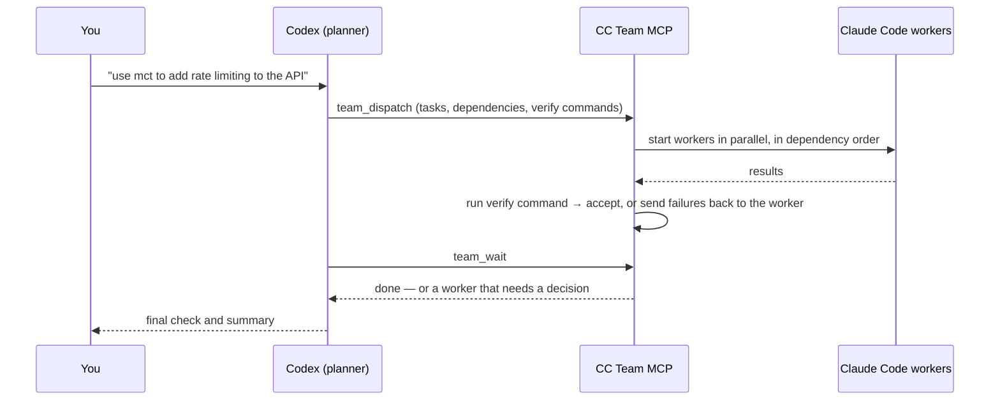

# CC Team MCP

[](https://github.com/lboverfys/mcp-cccx-together/actions/workflows/ci.yml)
[](LICENSE)

English | [简体中文](README.zh-CN.md)

**Let Codex plan. Let Claude Code do the work — in parallel.**

CC Team MCP is a local [MCP](https://modelcontextprotocol.io) server that turns [Codex](https://github.com/openai/codex) into a planner and coordinator for a team of [Claude Code](https://code.claude.com) workers. Codex splits a task, submits the whole plan in one call, and then waits. The server runs the workers in parallel, respects dependencies and file scopes, verifies each result with your own test command, and only wakes Codex up when a decision is actually needed.

Runs on Windows, macOS and Linux over standard MCP stdio. No network ports, no extra API keys — workers reuse your existing Claude Code installation, login and model settings.

## Contents

- [How it works](#how-it-works)
- [Before you start: permissions](#before-you-start-permissions)
- [Installation](#installation)
- [Usage](#usage)
- [Task options](#task-options)
- [Tools](#tools)
- [Configuration](#configuration)
- [Resuming work](#resuming-work)
- [Maintenance](#maintenance)
- [Troubleshooting](#troubleshooting)
- [Development](#development)
- [Contributing](#contributing)

## How it works



- **One dispatch, one wait.** Codex submits every task at once and blocks on `team_wait` instead of polling. Most runs need only a handful of Codex turns.
- **Dependency scheduling.** `dependsOn` chains tasks; the next task starts as soon as its inputs are accepted and receives the upstream result as a handoff.
- **Automatic verification.** Give a task a `verify` command (for example `npm test`). When the worker finishes, the server runs it: exit code 0 accepts the result; anything else sends the output back to the same worker to fix, up to `maxFixRounds` times.
- **Scope-aware parallelism.** Tasks that write to overlapping paths are queued in submission order; independent tasks run side by side (8 at a time by default).
- **Durable state.** Teams, results and reviews are stored on disk. Close Codex, come back tomorrow, and resume a worker by name with its Claude Code session intact.

## Before you start: permissions

> [!WARNING]
> By default, workers run with Claude Code's `bypassPermissions` mode: they can edit files and run commands **without asking**, with the same rights as your OS user. This is what makes the team fast, but it is only appropriate for code and machines you trust.
>
> - `scope` controls scheduling (which tasks may run at the same time). It is **not** a sandbox.
> - Prefer a dedicated git worktree, container or VM for write tasks.
> - To approve tool calls through Codex instead, set `permissionMode` to `default` or `acceptEdits` (see [Configuration](#configuration)).

Workers cannot start sub-agents, do not run your Claude Code hooks, and only see the coordination tools provided by this server (no other MCP servers).

## Installation

### Requirements

- **Node.js 22+** with npm
- **Claude Code**, installed and able to complete a conversation in your terminal ([setup guide](https://code.claude.com/docs/en/setup))
- **Codex CLI** — or any MCP client that supports local stdio servers
- **Git**, if installing from GitHub

### Install from GitHub (recommended)

```sh
npm install -g --omit=optional github:lboverfys/mcp-cccx-together
cc-team-mcp doctor
cc-team-mcp setup
```

- `doctor` checks Node, Claude Code, Codex and the state/temp directories. It makes no model calls and creates nothing.
- `setup` registers the server with Codex as `cc_team` (via `codex mcp add`). It refuses to overwrite an existing entry; use `--name` to pick another name.
- `--omit=optional` skips the Claude binary bundled with the Agent SDK; your installed Claude Code is used instead.

Open a new Codex session and run `/mcp` to confirm the server is connected.

> On Windows, if PowerShell blocks npm scripts, use `npm.cmd` and `cc-team-mcp.cmd`.

### Install from source

```sh
git clone https://github.com/lboverfys/mcp-cccx-together.git
cd mcp-cccx-together
npm ci --omit=optional
node src/cli.mjs doctor
node src/cli.mjs setup
```

Keep the directory in place — Codex starts the server from it. Re-run `setup` if you move it.

### Other MCP clients

```sh
cc-team-mcp print-config
```

prints an `mcpServers` JSON block with absolute paths for your installation. Add it to your client's local MCP configuration.

### Uninstall

```sh
codex mcp remove cc_team
npm uninstall -g cc-team-mcp
```

Saved team state is kept; delete the [state directory](#configuration) if you no longer need it.

## Usage

Mention **`mct`** (or **`ctm`**) in your request to Codex:

> use mct to add input validation to the signup endpoint and make sure the tests pass

> 使用 mct 检查这个项目的问题，先只读分析。

Codex then:

1. Splits the work and calls `team_dispatch` once with all tasks. A team is opened automatically (call `team_open` first only to set constraints, change concurrency or reopen an old team).
2. Calls `team_wait`, which blocks until every task has stopped or one needs attention.
3. Handles only workers marked `attention: true`:

   | Status | What Codex does |
   | --- | --- |
   | `needs_input` | Answers the worker's question with `team_reply` |
   | `failed`, or auto-review rejected | Sends a fix with `team_send`, or `team_close` and re-dispatch |
   | `blocked` | Fixes the upstream task listed in `blockedBy` |
   | `awaiting_review` (`review: "codex"`) | Reads the result with `team_result`, then `team_review` |

4. Repeats `team_wait` until `done: true`, then does a final check.

### Example plan

```json
{
  "workers": [
    { "name": "designcc", "cwd": "/abs/path/to/project", "prompt": "Write the API contract and acceptance criteria", "scope": ["src"] },
    { "name": "implcc", "cwd": "/abs/path/to/project", "prompt": "Implement the contract", "access": "write", "scope": ["src"], "dependsOn": ["designcc"], "verify": "npm test" },
    { "name": "checkcc", "cwd": "/abs/path/to/project", "prompt": "Review the implementation against the contract and run the test suite", "access": "verify", "dependsOn": ["implcc"] }
  ]
}
```

`designcc` finishes and is accepted automatically; `implcc` starts with the design as its handoff and keeps fixing until `npm test` passes; `checkcc` then reviews the result. Codex is only consulted if something gets stuck.

> [!NOTE]
> Worker instructions and tool descriptions are currently written in Chinese, and workers report in Chinese. Codex understands requests in any language. Contributions for English worker prompts are welcome.

## Task options

Each entry in `team_dispatch.workers` accepts:

| Field | Default | Description |
| --- | --- | --- |
| `name` | — | Short role name. `cc` is appended if missing; at most 10 characters including `cc`; unique within the team. |
| `cwd` | — | Absolute path of the project directory. |
| `prompt` | — | The task. State the goal, the files involved and how success is checked. |
| `access` | `read` | `read`: Read/Glob/Grep only. `verify`: also Bash, for running tests and builds (should not edit files). `write`: full toolset. |
| `scope` | whole `cwd` | Paths relative to `cwd` (not globs). **Required** for `write`. Overlapping write scopes run one after another. |
| `dependsOn` | `[]` | Names or IDs of tasks that must be accepted first; may reference tasks in the same batch. |
| `verify` | — | Shell command run in `cwd` after the worker succeeds. Exit code 0 means pass. Times out after 10 minutes. |
| `review` | `auto` | `auto`: accept when the worker succeeds and `verify` passes. `codex`: wait for Codex to call `team_review`. |
| `maxFixRounds` | `2` | How many times a failing `verify` is sent back to the worker before Codex is asked (0–5). |
| `instructions` | — | Extra constraints for this worker. |
| `model` | your Claude Code default | Model override for this worker. |
| `maxTurns`, `maxBudgetUsd` | — | Per-run limits enforced by the Claude Agent SDK. |
| `allowedTools` | `[]` | Claude Code permission rules to pre-approve (only relevant when `permissionMode` is not `bypassPermissions`). |

Team-wide options are set with `team_open`: `constraints` (text added to every worker's instructions), `maxConcurrent` (live Claude Code processes, default 8), and `teamId`.

## Tools

| Tool | Purpose |
| --- | --- |
| `team_dispatch` | Submit a batch of tasks; opens a team if none is open |
| `team_wait` | Block until all tasks stop or one needs attention; returns a compact summary |
| `team_open` | Create or reopen a team; set constraints and concurrency |
| `team_list` | List saved teams |
| `team_status` | Full state: dependencies, queue reasons, processes, requests, latest results and reviews |
| `team_events` | Raw event stream with cursor (for debugging; use `team_wait` to wait) |
| `team_request` | Read a pending question or permission request in full |
| `team_reply` | Answer a question, or allow/deny a tool call |
| `team_result` | Read a full result, paged (up to 100 KB per page) |
| `team_review` | Accept or reject a specific result version (`resultId` is required) |
| `team_send` | Send a follow-up instruction to a worker |
| `team_interrupt` | Interrupt a worker's current turn |
| `team_resume` | Restart a closed worker in its original Claude Code session |
| `team_close` | Stop specific workers, keeping their sessions |
| `team_shutdown` | Stop all workers and release the team |

Limits: 32 pending messages per worker, 2,000 retained events, 8 MiB per result. Store large artifacts as files in the project and report their paths.

## Configuration

No configuration file is needed for a standard install. To customise, copy [`team.config.example.json`](team.config.example.json), then pass it with `--config /absolute/path/team.config.json` (to `doctor`, `setup` and `print-config`) or set `CC_TEAM_CONFIG`.

| Field | Environment variable | Default | Description |
| --- | --- | --- | --- |
| `permissionMode` | `CC_TEAM_PERMISSION_MODE` | `bypassPermissions` | `bypassPermissions`, `acceptEdits`, or `default` (tool calls are approved by Codex via `team_reply`) |
| `waitTimeoutMs` | `CC_TEAM_WAIT_TIMEOUT_MS` | `50000` | Longest single `team_wait`, in ms. Must stay below the client's tool timeout |
| `claudeExecutable` | `CC_TEAM_CLAUDE_EXECUTABLE` | auto-detected | Absolute path to Claude Code |
| `codexExecutable` | `CC_TEAM_CODEX_EXECUTABLE` | auto-detected | Absolute path to Codex (used by `setup` and notifications) |
| `stateDir` | `CC_TEAM_STATE_DIR` | see below | Teams, workers, events and results |
| `tempDir` | `CC_TEAM_TEMP_DIR` | `<system temp>/cc-team-mcp` | Worker temp files |
| `notificationMode` | `CC_TEAM_NOTIFICATION_MODE` | `poll` | `poll` or `codex-queue` |

Environment variables override the file; `--config` overrides `CC_TEAM_CONFIG`. `setup` and `print-config` store explicit overrides in the registration so they survive client restarts. Default state directory: `%LOCALAPPDATA%\cc-team-mcp` (Windows), `~/Library/Application Support/cc-team-mcp` (macOS), `$XDG_STATE_HOME/cc-team-mcp` or `~/.local/state/cc-team-mcp` (Linux).

### Longer waits

Codex stops a tool call after its tool timeout, so `team_wait` returns after at most 50 seconds by default. For fewer Codex turns on long tasks, raise both limits in `~/.codex/config.toml`:

```toml
[mcp_servers.cc_team]
tool_timeout_sec = 600

[mcp_servers.cc_team.env]
CC_TEAM_WAIT_TIMEOUT_MS = "570000"
```

### Models and providers

Workers run your installed Claude Code with your user, project and local settings, so they use whatever model, provider and login Claude Code already uses. The server stores no credentials. If your provider is configured through environment variables, let Codex forward them:

```toml
[mcp_servers.cc_team]
env_vars = ["ANTHROPIC_API_KEY", "ANTHROPIC_AUTH_TOKEN", "ANTHROPIC_BASE_URL", "ANTHROPIC_MODEL", "HTTPS_PROXY", "HTTP_PROXY", "NO_PROXY"]
```

### Windows launcher

From a source checkout, `Start-TeamCodex.ps1` starts Codex in a project with the server attached for that session only — including the longer wait settings above and forwarding of provider environment variables. Your global Codex config is not modified.

```powershell
.\Start-TeamCodex.ps1 -ProjectPath C:\work\my-app
```

### Push notifications (optional)

With `notificationMode: "codex-queue"` and a Codex build that supports `codex queue`, the server also posts short event summaries to the Codex thread passed as `parentThreadId` to `team_open`. Delivery status appears in `team_status.notificationDelivery`. Polling with `team_wait` works without this.

## Resuming work

Everything a team needs to continue is kept in the state directory, and each worker keeps its Claude Code session. In a new Codex conversation:

> Reopen the previous team and let implcc continue with error handling.

Codex calls `team_list`, reopens the team with `team_open` and its `teamId`, then `team_resume` with the worker's name. Constraints, concurrency, dependencies and reviews are restored; messages that were never delivered are kept and sent in order after `team_resume`.

## Maintenance

Close a team before running maintenance commands. Both commands only preview changes until you add `--apply`.

```sh
# Delete old results, keeping the latest 3 per worker and anything still referenced
cc-team-mcp prune --team <teamId> --keep-results 3
cc-team-mcp prune --team <teamId> --keep-results 3 --apply

# Recover a team lock or a truncated event log after a crash (backups are kept)
cc-team-mcp recover --team <teamId>
cc-team-mcp recover --team <teamId> --apply
```

Back up the state directory before upgrading. Older formats are migrated on the next write; to roll back, restore the backup.

## Troubleshooting

| Problem | What to check |
| --- | --- |
| Claude Code not found | `claude --version` works in the same environment; then `cc-team-mcp doctor`, or set `claudeExecutable` |
| Codex doesn't show the tools | `codex mcp list` and `/mcp`; make sure the registered path still exists; open a new session |
| Auth or network errors in workers | Run Claude Code on its own in the same environment; check `env_vars` forwarding |
| `team_wait` fails with a tool timeout | Lower `CC_TEAM_WAIT_TIMEOUT_MS` or raise `tool_timeout_sec` ([Longer waits](#longer-waits)) |
| Task stays in `waiting_scope` | Look at `blockedBy`; it starts once that worker finishes and is accepted. Split scopes to run in parallel |
| Worker stays in `needs_input` | Read the request with `team_request`, answer with `team_reply` |
| "Team is held by another process" | Close the other session, or run `recover` after a crash |
| Close fails | A Claude Code background task could not be confirmed stopped. Check it yourself before retrying; don't delete the lock |
| "Event log tail is incomplete" | Run `recover` (preview first). Don't delete the event log |

State files contain task text, progress and tool inputs in plain text. Keep the state directory private, and don't attach it to issues.

## Development

```sh
npm ci --omit=optional
npm run check   # syntax check
npm test        # full suite with a simulated Claude Code process — no model calls
npm pack --dry-run
```

CI runs on Windows, macOS and Linux with Node.js 22 and 24.

`node scripts/smoke-live.mjs` runs an end-to-end session against your real Claude Code (two read-only workers, questions, multiple turns, resume). It **costs money**: each worker process is limited to 8 turns and an SDK-estimated $1. Add `--notify` to also test Codex notifications.

## Contributing

Issues and pull requests are welcome.

- **Bug reports:** include OS and architecture, Node and Claude Code versions, redacted `cc-team-mcp doctor` output, minimal steps to reproduce, and what you expected. Never attach your state directory or API keys.
- **Pull requests:** add a test that reproduces the problem. If you change the tool protocol, update the tool descriptions, both READMEs and `scripts/smoke-live.mjs` too. CI must pass on all three platforms.

## License

[MIT](LICENSE). Third-party dependencies are under their own licenses.
