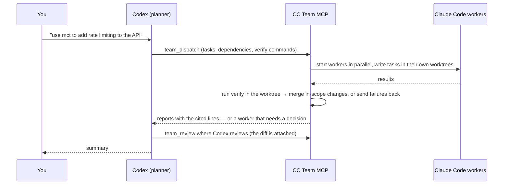

# CC Team MCP

[](https://github.com/lboverfys/mcp-cccx-together/actions/workflows/ci.yml)
[](LICENSE)

English | [简体中文](README.zh-CN.md)

**Let Codex plan. Let fast workers do the work — in parallel.**

CC Team MCP is a local [MCP](https://modelcontextprotocol.io) server that turns [Codex](https://github.com/openai/codex) into a planner and reviewer for a team of [Claude Code](https://code.claude.com) workers. The workers can run on Claude or on any model with an Anthropic-compatible API, such as DeepSeek. Codex splits a task, submits the whole plan in one call, and waits. The server runs the workers in parallel, each write task in its own git worktree. It checks every result with your test command and merges only the in-scope changes back. Codex is woken only when a decision is needed.

Runs on Windows, macOS and Linux over standard MCP stdio. No network ports, and no extra API keys unless you add a provider. Workers reuse your existing Claude Code installation and login.

> [!NOTE]
> **This project is Chinese-first.** Worker prompts, tool descriptions and error messages are in Chinese, and workers report in Chinese. Codex understands requests in any language. Both READMEs are maintained.

**Names:** the npm package and CLI are `cc-team-mcp`. `setup` registers the server in Codex as `cc_team`. Mention `mct` or `ctm` in a request to use it. The repository is `mcp-cccx-together`.

## Contents

- [How it works](#how-it-works)
- [Before you start: permissions](#before-you-start-permissions)
- [Installation](#installation)
- [Usage](#usage)
- [Task options](#task-options)
- [Tools](#tools)
- [Isolation and merging](#isolation-and-merging)
- [Models and providers](#models-and-providers)
- [Configuration](#configuration)
- [Resuming work](#resuming-work)
- [Measuring speed](#measuring-speed)
- [Maintenance](#maintenance)
- [Troubleshooting](#troubleshooting)
- [Development](#development)
- [Contributing](#contributing)

## How it works



- **One call per delegation.** Codex is the slow part, so the server saves Codex turns. `team_dispatch` submits every task at once and by default returns only when they have all stopped or one needs a decision, like Claude Code's own sub-agents. Codex hands over everything that needs reading code, searching, running commands or editing, and doesn't investigate first.
- **Verified, not self-reported.** With a `verify` command (for example `npm test`) the server checks the result itself and sends failures back to the same worker, up to `maxFixRounds` times. For write tasks without `verify`, Codex reviews the result before anything downstream starts.
- **Each job is done once.** Read and verify tasks are accepted as soon as they finish, their processes are closed, and the full report comes back with the dispatch. Workers report in a fixed short format: an answer Codex can pass on as-is, `file:line` evidence, and verified facts kept apart from guesses. The server reads every cited line and returns it as `evidence`, flagging citations that don't exist, so Codex checks a report without opening files or repeating the investigation.
- **Isolated, parallel writes.** In a git repository, each write task works in its own git worktree, so write tasks run in parallel even when their scopes overlap. Their test runs don't see each other's half-finished edits. On acceptance, only changes inside the task's `scope` are merged back; anything outside is rejected. If another task changed the same lines first, the server merges the latest working tree into the worker's worktree, leaves conflict markers, and sends it back to the same worker.
- **Parallel inside a worker.** Codex doesn't read the code before delegating, so it often can't split a task. Workers can, using Claude Code's own sub-agents: read and verify tasks fan out to the read-only Explore agent, write tasks may also use general-purpose agents, which are bound to the same scope.
- **No extra sessions for plain commands.** A verify task without a prompt is a command task: the server runs its `verify` command directly, without starting Claude Code. Use it for the final test run after several writes.
- **Dependency scheduling.** `dependsOn` chains tasks. The next task starts as soon as its inputs are accepted and receives the upstream result as a handoff.
- **Any Anthropic-compatible model.** Define providers (for example DeepSeek) once, then pick one per task.
- **Durable state.** Teams, results and reviews are stored on disk. Close Codex, come back tomorrow, and resume a worker by name with its Claude Code session intact.

## Before you start: permissions

> [!WARNING]
> By default, workers run with Claude Code's `bypassPermissions` mode: they can edit files and run commands **without asking**, with the same rights as your OS user. This is what makes the team fast, but it is only appropriate for code and machines you trust.
>
> - Write tasks get their own git worktree (see [Isolation and merging](#isolation-and-merging)). File-editing tools (`Edit`, `Write`, `MultiEdit`, `NotebookEdit`) refuse paths outside the task's `scope`.
> - This is **not** a sandbox. Shell commands can still read and write anywhere your user can. Linked dependency folders such as `node_modules` are shared with your main checkout.
> - Use a container or VM for code you don't trust.
> - To approve tool calls through Codex instead, set `permissionMode` to `default` or `acceptEdits` (see [Configuration](#configuration)).

Unless a task sets `explore: false`, workers may start Claude Code sub-agents: read and verify tasks only the read-only Explore agent, write tasks also general-purpose agents. Sub-agents cannot start further sub-agents, and their file edits are limited to the task's scope too. Workers don't run your Claude Code hooks, and they only see the coordination tools provided by this server (no other MCP servers).

## Installation

### Requirements

- **Node.js 22+** with npm
- **Claude Code**, installed and able to complete a conversation in your terminal ([setup guide](https://code.claude.com/docs/en/setup))
- **Codex CLI**, or any MCP client that supports local stdio servers
- **Git 2.38+**, for worktree isolation (and for installing from GitHub)

### Install from GitHub (recommended)

```sh
npm install -g --omit=optional github:lboverfys/mcp-cccx-together
cc-team-mcp doctor
cc-team-mcp setup
```

- `doctor` checks Node, Claude Code, Codex, the state/temp directories, and whether Codex lets `team_wait` block long enough (`codexWait`). It makes no model calls and creates nothing.
- `setup` registers the server with Codex as `cc_team` (via `codex mcp add`). It also sets Codex's tool timeout so that `team_wait` can block for up to 9.5 minutes, and forwards any provider credentials (see [Longer waits](#longer-waits)). It refuses to overwrite an existing entry; use `--name` to pick another name.
- `--omit=optional` skips the Claude binary bundled with the Agent SDK; your installed Claude Code is used instead.

Open a new Codex session and run `/mcp` to confirm the server is connected.

> On Windows, if PowerShell blocks npm scripts, use `npm.cmd` and `cc-team-mcp.cmd`.

### Install from source

```sh
git clone https://github.com/lboverfys/mcp-cccx-together.git
cd mcp-cccx-together
npm ci --omit=optional
node src/cli.mjs doctor
node src/cli.mjs setup
```

Keep the directory in place — Codex starts the server from it. Re-run `setup` if you move it.

### Other MCP clients

```sh
cc-team-mcp print-config
```

prints an `mcpServers` JSON block with absolute paths for your installation. Add it to your client's local MCP configuration.

### Uninstall

```sh
codex mcp remove cc_team
npm uninstall -g cc-team-mcp
```

Saved team state is kept; delete the [state directory](#configuration) if you no longer need it.

## Usage

Mention **`mct`** (or **`ctm`**) in your request to Codex:

> use mct to add input validation to the signup endpoint and make sure the tests pass

> 使用 mct 检查这个项目的问题，先只读分析。

Codex then:

1. Writes the clues it already has (error text, IDs, paths) into short prompts and calls `team_dispatch` once with all tasks, one worker per independent question. It doesn't search the code first. A team is opened automatically (call `team_open` first only to set constraints, change concurrency or reopen an old team).
2. The call blocks until every task has stopped or one needs attention, and returns what `team_wait` returns: each stopped worker's full report (`summaryTruncated: true` if it is too long; read the rest with `team_result`), the cited lines as `evidence`, and the run's `durationMs` and `turns`. If the wait times out (`timedOut: true`), Codex calls `team_wait`. Pass `wait: false` to return right away when Codex has unrelated work of its own.
3. Handles only workers marked `attention: true`:

   | Status | What Codex does |
   | --- | --- |
   | `needs_input` | Answers the worker's question with `team_reply` |
   | `failed`, or auto-review rejected | Sends a fix with `team_send`, or `team_close` and re-dispatch |
   | `stopped` | The worker's process exited; `team_resume` it or close it |
   | `blocked` | Fixes the upstream task listed in `blockedBy` |
   | `awaiting_review` | Checks the `diff` attached to the result (`team_diff` pages through a long patch), then `team_review` |

4. Repeats `team_wait` until `done: true` and passes the reports on. After several write tasks, the overall test run is a command task in the same batch that depends on all of them (`access: "verify"`, a `verify` command, no `prompt`), not a Codex step. Auto-accepted read and verify workers are already closed, so no `team_close` is needed; use `team_resume` for follow-ups.

Workers ask Codex (`needs_input`) only when an action is destructive or a wrong guess would waste the work. Otherwise they go with the most reasonable reading and state the assumption in the report.

### Example plan

```json
{
  "workers": [
    { "name": "designcc", "cwd": "/abs/path/to/project", "prompt": "Write the API contract and acceptance criteria", "scope": ["src"] },
    { "name": "apicc", "cwd": "/abs/path/to/project", "prompt": "Implement the API part of the contract", "access": "write", "scope": ["."], "dependsOn": ["designcc"], "verify": "auto", "provider": "deepseek" },
    { "name": "uicc", "cwd": "/abs/path/to/project", "prompt": "Implement the UI part of the contract", "access": "write", "scope": ["."], "dependsOn": ["designcc"], "verify": "auto" },
    { "name": "testcc", "cwd": "/abs/path/to/project", "access": "verify", "verify": "npm test", "dependsOn": ["apicc", "uicc"] }
  ]
}
```

1. `designcc` is read-only, so it is accepted when it finishes and its process is closed.
2. `apicc` (on DeepSeek) and `uicc` start together from the design handoff, each in its own worktree. `verify: "auto"` finds the test command from the project files (here `npm test`); each keeps fixing until it passes, then its changes are merged back. If both touched the same lines, the second one gets the conflict back and resolves it.
3. `testcc` is a command task: once both writes are merged, the server runs `npm test` in your working tree, without starting Claude Code. Its output reaches Codex through `team_wait`.

## Task options

Each entry in `team_dispatch.workers` accepts:

| Field | Default | Description |
| --- | --- | --- |
| `name` | — | Short role name. `cc` is appended if missing; at most 24 characters including `cc`; unique within the team. |
| `cwd` | — | Absolute path of the project directory. |
| `prompt` | — | The task. State the question or goal and the clues you already have; the worker does the searching. Leave it out on a verify task with `verify` to make a command task. |
| `access` | `read` | `read`: Read/Glob/Grep only. `verify`: also Bash, for tests, builds, git history, logs or running a program (should not edit files). `write`: full toolset. |
| `scope` | whole `cwd` | Paths relative to `cwd` (not globs). **Required** for `write`; use `["."]` when you don't know which files will change. File-editing tools and merging are limited to it. Isolated write tasks run in parallel even if their scopes overlap; shared ones and verify tasks wait for overlapping writers. |
| `dependsOn` | `[]` | Names or IDs of tasks that must be accepted first; may reference tasks in the same batch. |
| `verify` | — | Shell command run after the worker succeeds, in the worker's worktree for isolated tasks. Exit code 0 means pass. Times out after 10 minutes. `auto` picks the command from the project files (`package.json` test script, `go.mod`, `Cargo.toml`, pytest config, Gradle, Maven, .NET, `make test`), searching up to the repository root; if none is found, a write task falls back to Codex review. |
| `review` | `auto` for read and verify tasks and for write tasks with `verify`, otherwise `codex` | `auto`: accept when the worker succeeds and `verify` (if any) passes; read and verify workers are then closed. `codex`: wait for Codex to call `team_review`. Write tasks need a `verify` command to use `auto`. |
| `explore` | `true` | Let the worker split its work across Claude Code sub-agents when that pays off: Explore for read and verify tasks, also general-purpose for write tasks. Sub-agents cannot nest. `false` turns it off. |
| `maxFixRounds` | `2` | How many times a failing `verify`, an out-of-scope change or a merge conflict is sent back to the worker before Codex is asked (0–5). A `verify` command that cannot run at all (command not found) goes to Codex right away. |
| `isolation` | `worktree` for write tasks in a git repository | `worktree` or `shared`. See [Isolation and merging](#isolation-and-merging). |
| `links` | `node_modules`, `.venv`, `venv` | Ignored paths (relative to `cwd`) linked from the main checkout into the worktree, for example `.env`. Only used with `worktree`. |
| `provider` | `defaultProvider`, if set | Which configured provider runs this worker. See [Models and providers](#models-and-providers). |
| `instructions` | — | Extra constraints for this worker. |
| `model` | the provider's model, or your Claude Code default | Model override for this worker. |
| `maxTurns`, `maxBudgetUsd` | — | Per-run limits enforced by the Claude Agent SDK. `maxBudgetUsd` uses Anthropic prices, so it is not a real limit for other providers. |
| `allowedTools` | `[]` | Claude Code permission rules to pre-approve (only relevant when `permissionMode` is not `bypassPermissions`). |

Team-wide options are set with `team_open`: `constraints` (text added to every worker's instructions), `maxConcurrent` (live Claude Code processes, default 8), and `teamId`.

## Tools

| Tool | Purpose |
| --- | --- |
| `team_dispatch` | Submit a batch of tasks (opens a team if none is open) and, unless `wait: false`, wait and return what `team_wait` returns |
| `team_wait` | Block until all tasks stop or one needs attention; returns each stopped worker's full report, the cited lines (`evidence`), and the diff of write results awaiting review |
| `team_open` | Create or reopen a team; set constraints and concurrency; lists configured providers |
| `team_list` | List saved teams |
| `team_status` | Full state: dependencies, queue reasons, processes, worktrees, requests, latest results and reviews, and `timing` (see [Measuring speed](#measuring-speed)) |
| `team_events` | Raw event stream with cursor (for debugging; use `team_wait` to wait) |
| `team_request` | Read a pending question or permission request in full |
| `team_reply` | Answer a question, or allow/deny a tool call |
| `team_result` | Read a full result, paged (up to 100 KB per page) |
| `team_diff` | Show an isolated task's unmerged changes: files, out-of-scope files, stat and a paged patch |
| `team_review` | Accept or reject a specific result version (`resultId` is required); accepting an isolated task merges it, and a merge conflict is sent back to the worker (`sentBack: true`) |
| `team_send` | Send a follow-up instruction to a worker |
| `team_interrupt` | Interrupt a worker's current turn |
| `team_resume` | Restart a closed worker in its original Claude Code session |
| `team_close` | Stop specific workers, keeping their sessions |
| `team_shutdown` | Stop all workers and release the team |

Limits: 32 pending messages per worker, 2,000 retained events, 8 MiB per result. Store large artifacts as files in the project and report their paths.

## Isolation and merging

Write tasks whose `cwd` is inside a git repository run in their own [git worktree](https://git-scm.com/docs/git-worktree) by default. Outside a git repository they edit your files directly (`shared`), and `team_dispatch` returns a warning.

- **Starting point.** The worktree starts from a snapshot of your working tree at the moment the task starts, including uncommitted changes and untracked files that aren't ignored. Write tasks started together share one snapshot. Your branch, index and `HEAD` are not touched. The snapshot commits are not on any branch.
- **Location.** `<stateDir>/<teamId>/worktrees/<workerId>`. The state directory must be outside the repository.
- **Dependencies.** Ignored folders the tests need are linked from your checkout: `node_modules`, `.venv` and `venv` by default. Add more with `links`. Linked folders are shared, so a worker that reinstalls packages changes your main `node_modules`.
- **Paths.** Absolute paths to your project in messages to the worker are rewritten to the worktree. File-editing tools refuse paths outside the task's scope in the worktree.
- **Acceptance merges.** When a result is accepted, by auto review or `team_review`, the server takes the changes the worker made since its starting point:
  - Every changed path must be inside `scope`. Otherwise acceptance fails. Auto review sends the list back to the worker within `maxFixRounds`; `team_review` returns an error.
  - If you or another task changed the same files in the meantime, the server does a three-way merge. On a conflict nothing is merged: the server merges your current working tree into the worker's worktree, leaving conflict markers, moves the worker's starting point forward, and sends the worker the list of conflicted files (under auto review this counts against `maxFixRounds`). When the worker reports again, the result goes through `verify` and merging as usual.
  - Merged files are written to your working tree only. Nothing is staged or committed.
- **Parallel work.** An isolated write task doesn't change your working tree until it is merged, so read tasks and other isolated write tasks with overlapping scopes run alongside it. Verify tasks run commands in your working tree, so they still wait.
- **Review before merging.** A write result waiting for Codex's review comes with its changed files, out-of-scope files and up to 12,000 characters of patch. `team_diff` pages through the rest.
- **Cleanup.** Closing a worker removes its worktree if everything was merged. A worktree with unmerged changes is kept (its path is in `team_status`). `team_resume` recreates a removed worktree at the same path, so the Claude Code session continues. `prune` removes leftover clean worktrees.

Downstream tasks start from a snapshot taken after upstream changes were merged, so they see them.

## Models and providers

By default workers use your installed Claude Code with your user, project and local settings: whatever model, provider and login Claude Code already uses. The server stores no credentials.

To route workers to another Anthropic-compatible API, define **providers** in the [configuration file](#configuration). Use `env` for non-secret values. Use `envFrom` to copy a secret from a variable that is already set for the MCP server, so the key never sits in the file:

```json
{
  "providers": {
    "deepseek": {
      "description": "DeepSeek through its Anthropic-compatible API",
      "env": {
        "ANTHROPIC_BASE_URL": "https://api.deepseek.com/anthropic",
        "ANTHROPIC_DEFAULT_HAIKU_MODEL": "deepseek-chat"
      },
      "envFrom": { "ANTHROPIC_AUTH_TOKEN": "DEEPSEEK_API_KEY" },
      "model": "deepseek-chat"
    }
  },
  "defaultProvider": "deepseek"
}
```

- Pick a provider per task with `provider`, or for every task with `defaultProvider` (or `CC_TEAM_DEFAULT_PROVIDER`). Codex sees the provider list in the server instructions and in `team_open`.
- `setup` adds the `envFrom` source variables (here `DEEPSEEK_API_KEY`) to Codex's `env_vars`, so Codex passes them through. The Windows launcher does the same. A dispatch that needs a variable that isn't set fails with a clear message.
- **DeepSeek:** the base URL above comes from DeepSeek's [Anthropic API guide](https://api-docs.deepseek.com/guides/anthropic_api). Model names change between releases, so check that guide for current ones. Point `ANTHROPIC_DEFAULT_HAIKU_MODEL` (and the Sonnet/Opus equivalents, if your Claude Code uses them) at a DeepSeek model, so Claude Code's background calls also go to DeepSeek.
- If your `~/.claude/settings.json` sets `ANTHROPIC_*` variables in its `env` block, Claude Code may prefer those over the provider's values. Move them into a provider instead.
- **Costs:** `costUsd` and `maxBudgetUsd` are SDK estimates based on Anthropic prices. For workers on another provider, results carry `costReliable: false`, and `maxBudgetUsd` triggers a warning. Use `maxTurns` to limit work.

If Claude Code itself is configured through environment variables (no providers), let Codex forward them:

```toml
[mcp_servers.cc_team]
env_vars = ["ANTHROPIC_API_KEY", "ANTHROPIC_AUTH_TOKEN", "ANTHROPIC_BASE_URL", "ANTHROPIC_MODEL", "HTTPS_PROXY", "HTTP_PROXY", "NO_PROXY"]
```

## Configuration

No configuration file is needed for a standard install. To customise, copy [`team.config.example.json`](team.config.example.json), then pass it with `--config /absolute/path/team.config.json` (to `doctor`, `setup` and `print-config`) or set `CC_TEAM_CONFIG`.

| Field | Environment variable | Default | Description |
| --- | --- | --- | --- |
| `permissionMode` | `CC_TEAM_PERMISSION_MODE` | `bypassPermissions` | `bypassPermissions`, `acceptEdits`, or `default` (tool calls are approved by Codex via `team_reply`) |
| `waitTimeoutMs` | `CC_TEAM_WAIT_TIMEOUT_MS` | `50000` (`setup` registers `570000`) | Longest single `team_wait`, in ms. Must stay below the client's tool timeout |
| `providers` | — | none | Named Anthropic-compatible providers (see [Models and providers](#models-and-providers)) |
| `defaultProvider` | `CC_TEAM_DEFAULT_PROVIDER` | none | Provider used when a task doesn't name one |
| `claudeExecutable` | `CC_TEAM_CLAUDE_EXECUTABLE` | auto-detected | Absolute path to Claude Code |
| `codexExecutable` | `CC_TEAM_CODEX_EXECUTABLE` | auto-detected | Absolute path to Codex (used by `setup` and notifications) |
| `stateDir` | `CC_TEAM_STATE_DIR` | see below | Teams, workers, events, results and worktrees. Keep it outside your repositories |
| `tempDir` | `CC_TEAM_TEMP_DIR` | `<system temp>/cc-team-mcp` | Worker temp files |
| `notificationMode` | `CC_TEAM_NOTIFICATION_MODE` | `poll` | `poll` or `codex-queue` |

Environment variables override the file; `--config` overrides `CC_TEAM_CONFIG`. `setup` and `print-config` store explicit overrides in the registration so they survive client restarts. Default state directory: `%LOCALAPPDATA%\cc-team-mcp` (Windows), `~/Library/Application Support/cc-team-mcp` (macOS), `$XDG_STATE_HOME/cc-team-mcp` or `~/.local/state/cc-team-mcp` (Linux).

### Longer waits

Codex stops a tool call after its tool timeout. Each wait that times out, whether in `team_dispatch` or `team_wait`, costs Codex another turn, so longer waits mean fewer slow Codex turns. When the limit is under two minutes, a timed-out result carries a `hint` saying so.

`setup` handles this for you. It registers `CC_TEAM_WAIT_TIMEOUT_MS = 570000` and writes `tool_timeout_sec = 600` into the `[mcp_servers.cc_team]` table of `~/.codex/config.toml` (or `$CODEX_HOME/config.toml`). If you set `waitTimeoutMs` yourself, `setup` keeps it and sets the tool timeout 30 seconds higher. If `setup` cannot edit the file, it registers the safe 50-second default and prints the manual steps.

`cc-team-mcp doctor` reads these two settings from the Codex config and reports them under `checks.codexWait`, with a hint when the wait is short.

For a manual setup, raise both limits together:

```toml
[mcp_servers.cc_team]
tool_timeout_sec = 600

[mcp_servers.cc_team.env]
CC_TEAM_WAIT_TIMEOUT_MS = "570000"
```

### Windows launcher

From a source checkout, `Start-TeamCodex.ps1` starts Codex in a project with the server attached for that session only. This includes the longer wait settings and forwarding of provider environment variables, including those named in `envFrom`. Your global Codex config is not modified.

```powershell
.\Start-TeamCodex.ps1 -ProjectPath C:\work\my-app
```

### Push notifications (optional)

With `notificationMode: "codex-queue"` and a Codex build that supports `codex queue`, the server also posts short event summaries to the Codex thread passed as `parentThreadId` to `team_open`. Delivery status appears in `team_status.notificationDelivery`. Polling with `team_wait` works without this.

## Resuming work

Everything a team needs to continue is kept in the state directory, and each worker keeps its Claude Code session. In a new Codex conversation:

> Reopen the previous team and let implcc continue with error handling.

Codex calls `team_list`, reopens the team with `team_open` and its `teamId`, then `team_resume` with the worker's name. Constraints, concurrency, dependencies, reviews and worktrees are restored. Messages that were never delivered are kept and sent in order after `team_resume`.

## Measuring speed

The point of delegating is to finish sooner, so measure it instead of guessing. The server times every team:

- `codex` — Codex's own time between two calls to this server (its reasoning, tools it ran itself and its replies), and how many such turns there were. Planning before the first call can't be seen. Gaps over 5 minutes usually include you, so they are only counted (`longGapsExcluded`).
- `mcpCalls` — calls to this server, and how long Codex was blocked in `team_dispatch` and `team_wait`.
- `workerRunMs`, `verifyMs`, `mergeMs`, `worktreeMs` — Claude Code run time (or command time for command tasks), and the server's own verify, merge and worktree work. Each worker's own figures are in `team_status`.

Ask Codex for `team_status`, or read it from a terminal at any time, even while the team is open:

```sh
cc-team-mcp stats --team <teamId>
```

Codex's own turns are usually the largest share. Two settings cut them down:

- Long waits ([Longer waits](#longer-waits)), so Codex isn't woken every 50 seconds while workers run.
- A lower Codex reasoning effort for delegated sessions, for example a Codex profile with `model_reasoning_effort = "medium"`. With mct, Codex mostly splits tasks and relays reports.

## Maintenance

Close a team before running `prune` or `recover`. Both only preview changes until you add `--apply`.

```sh
# Delete old results (keeping the latest 3 per worker and anything still referenced)
# and worktrees of closed workers that have no unmerged changes
cc-team-mcp prune --team <teamId> --keep-results 3
cc-team-mcp prune --team <teamId> --keep-results 3 --apply

# Recover a team lock or a truncated event log after a crash (backups are kept)
cc-team-mcp recover --team <teamId>
cc-team-mcp recover --team <teamId> --apply
```

Back up the state directory before upgrading. Older formats are migrated on the next write; to roll back, restore the backup. See the [changelog](CHANGELOG.md) for behaviour changes between versions.

## Troubleshooting

| Problem | What to check |
| --- | --- |
| Claude Code not found | `claude --version` works in the same environment; then `cc-team-mcp doctor`, or set `claudeExecutable` |
| Codex doesn't show the tools | `codex mcp list` and `/mcp`; make sure the registered path still exists; open a new session |
| Auth or network errors in workers | Run Claude Code on its own in the same environment; check `env_vars` forwarding |
| "provider … 需要环境变量 …" (needs a variable) | The `envFrom` source variable isn't reaching the server. Re-run `setup`, or add it to `env_vars` |
| `team_wait` fails with a tool timeout | Lower `CC_TEAM_WAIT_TIMEOUT_MS` or raise `tool_timeout_sec` ([Longer waits](#longer-waits)) |
| Acceptance fails with "超出分配范围" (out of scope) | `team_diff` lists `outsideScope`. Ask the worker to revert those files, or re-dispatch with a wider `scope` |
| Acceptance fails with "冲突" (conflict) | The conflict was sent back to the worker until `maxFixRounds` ran out, or the worker's process had exited. `team_resume` the worker to resolve it, or reject the result and re-dispatch from the current state |
| Auto review fails with "找不到命令或程序" (command not found) | The `verify` command can't run in that directory. Fix the command (or use `auto`) and `team_send` the worker, or review it yourself |
| `verify` fails in a worktree with missing modules | Add the ignored folder or file the tests need to `links` |
| "stateDir 位于该 git 仓库内" | Move `stateDir` outside the repository, or use `isolation: "shared"` |
| Task stays in `waiting_scope` | Look at `blockedBy`; it starts once that worker finishes and is accepted. Only shared-mode writers and verify tasks wait for overlapping scopes; split scopes to run them in parallel |
| Worker stays in `needs_input` | Read the request with `team_request`, answer with `team_reply` |
| "Team is held by another process" | Close the other session, or run `recover` after a crash |
| Close fails | A Claude Code background task could not be confirmed stopped. Check it yourself before retrying; don't delete the lock |
| "Event log tail is incomplete" | Run `recover` (preview first). Don't delete the event log |

State files contain task text, progress and tool inputs in plain text. Keep the state directory private, and don't attach it to issues. See [SECURITY.md](SECURITY.md) for reporting vulnerabilities.

## Development

```sh
npm ci --omit=optional
npm run check   # syntax check
npm test        # full suite with a simulated Claude Code process and temporary git repositories — no model calls
npm pack --dry-run
```

CI runs on Windows, macOS and Linux with Node.js 22 and 24.

`node scripts/smoke-live.mjs` runs an end-to-end session against your real Claude Code (two read-only workers, questions, multiple turns, resume). It **costs money**: each worker process is limited to 8 turns and an SDK-estimated $1. Add `--notify` to also test Codex notifications.

Code layout: `src/server.mjs` (MCP tools), `src/manager.mjs` (team state machine and scheduling), `src/claude-worker.mjs` (one Claude Code process), `src/isolation.mjs` and `src/worktree.mjs` (worktrees and merging), `src/store.mjs` and `src/results.mjs` (durable state), `src/evidence.mjs` (reading cited lines for reports), `src/providers.mjs`, `src/config.mjs`, `src/cli.mjs`.

## Contributing

Issues and pull requests are welcome.

- **Bug reports:** include OS and architecture, Node, git and Claude Code versions, redacted `cc-team-mcp doctor` output, minimal steps to reproduce, and what you expected. Never attach your state directory or API keys.
- **Pull requests:** add a test that reproduces the problem. If you change the tool protocol, update the tool descriptions, both READMEs, `CHANGELOG.md` and `scripts/smoke-live.mjs` too. Keep worker-facing text in Chinese. CI must pass on all three platforms.

## License

[MIT](LICENSE). Dependencies keep their own licenses. `@anthropic-ai/claude-agent-sdk` is not open source: it is provided under Anthropic's [legal terms](https://code.claude.com/docs/en/legal-and-compliance), which apply when you install and run this project.
