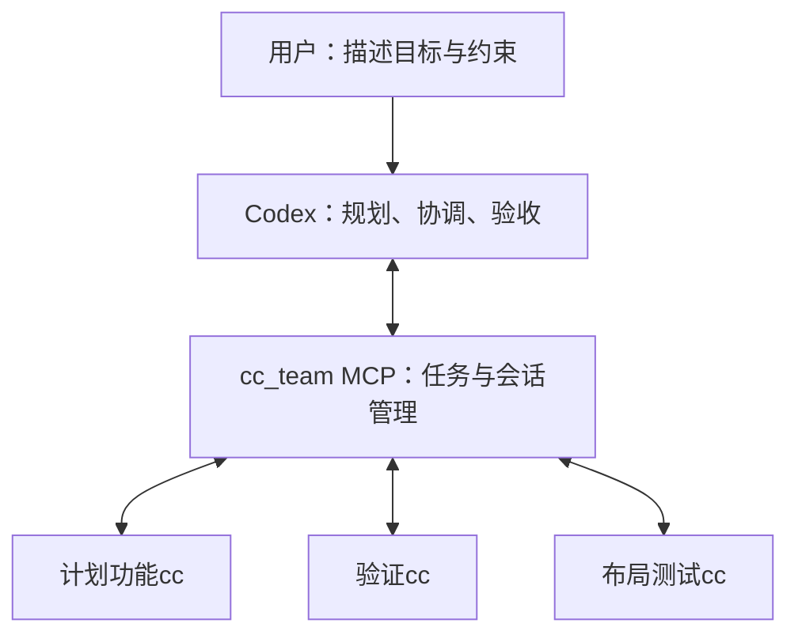

# mcp-cccx-together

让 **Codex 负责规划、协调和验收，Claude Code 负责执行** 的本地多 Agent 协作 MCP。

在 Codex 中用自然语言安排任务，它便可以按需启动多个 Claude Code（简称 CC）工作者，接收进度、回答问题、追加指令，并在验收后关闭进程、保留会话。两个客户端各自使用原有的模型配置；桥接程序不绑定某个模型提供商。

> 当前面向 **Windows + PowerShell 7 + Node.js 22 或更新版本**。已验证本机 Codex 与 Claude Code 的协作流程；其他操作系统尚未验证。模型服务仍需兼容各自客户端，尤其是 Claude Code 的工具调用。



## 能做什么

- **按需增加工作者**：没有固定工作者数量上限，支持批量派发、查询和关闭；实际规模受本机资源、模型服务配额及状态存储限制。
- **按名字协作**：名字采用“职责 + cc”，完整名字不超过十个字符，例如 `计划功能cc`、`验证cc`、`布局测试cc`。
- **双向沟通**：CC 汇报进度、提出问题；Codex 读取事件、回答请求、追加任务或中断当前轮次。
- **保留与恢复会话**：关闭执行进程后保存会话标识，后续可以在原团队中按名字恢复。
- **由主控验收**：CC 报告成功后仍处于待验收状态，Codex 检查实际改动与测试结果，再记录验收。
- **检查并行范围**：通过任务的 `scope` 检测读写冲突，帮助主控安排并行或串行执行。

这是通过 MCP 管理独立 CC 会话的协作桥接，不依赖 Claude Code 的 Agent Teams 功能。

## 快速开始

### 1. 准备已有工具

先确保以下工具能够独立运行：

- PowerShell 7；
- Node.js 22 或更新版本，`node` 可在当前终端找到；
- 已完成模型及鉴权配置的 Claude Code；
- 已完成配置的 Codex CLI。主动通知需要其原生入口支持 `codex queue --thread ... --resume`。

本项目复用已有客户端，不负责安装 Codex、Claude Code 或配置模型账号。已完成真实联调的客户端版本为 Claude Code `2.1.318`、Codex `0.167.0`；这不是对所有其他版本的兼容承诺。

### 2. 克隆并安装依赖

以下示例将项目放在 `D:\projects`，可换成自己的目录。在 PowerShell 7 中执行：

```powershell
git clone https://github.com/lboverfys/mcp-cccx-together.git D:\projects\mcp-cccx-together
Set-Location D:\projects\mcp-cccx-together
npm ci --omit=optional --ignore-scripts --cache D:\rubbish\zhongjian\caches\node
```

依赖保存在项目的 `node_modules`，上面的命令仅为本次安装指定 npm 缓存目录，不修改全局配置。依赖版本已锁定；省略可选依赖和安装脚本，是为了复用已有 CC 可执行文件，避免另外下载平台二进制。本项目没有编译步骤。

### 3. 配置本机路径

首次使用时复制示例，再用编辑器修改 `team.config.json`：

```powershell
Copy-Item .\team.config.example.json .\team.config.json
```

示例中的路径只是占位，必须换成自己机器上的绝对路径：

| 字段 | 用途 |
| --- | --- |
| `claudeExecutable` | 已有的原生 `claude.exe` 文件 |
| `codexExecutable` | 已有的原生 `codex.exe` 文件，用于启动主控及投递通知 |
| `stateDir` | 团队元数据、事件和锁文件的保存目录 |
| `tempDir` | 本项目启动的 CC 工作者使用的临时目录 |

可以用下面的命令检查当前入口：

```powershell
Get-Command node, claude, codex -All | Select-Object Name, Source
```

如果 `claude` 或 `codex` 指向 `.ps1` / `.cmd` 包装器，请找到其对应安装目录里的原生 `.exe`，不要把包装器填入配置。通过 npm 安装的客户端，其原生文件可能位于对应包的 `bin` 或平台包的 `vendor` 目录中，具体以实际安装结构为准。

配置不要求填写 API 密钥。CC 继续使用现有用户、项目及本地设置和当前环境中的模型配置；身份、授权和会话记录仍保存在 CC 自己的标准位置。

`team.config.json`、`.codex/config.toml`、`node_modules` 及默认运行状态目录已被 Git 忽略。若把状态目录改到项目内的其他位置，请相应排除它。任务文本、模型输出和 stderr 可能进入状态记录，应按任务内容决定其保密与保留方式。

### 4. 启动带团队工具的 Codex

将 `-ProjectPath` 指向需要协作的项目：

```powershell
& 'D:\projects\mcp-cccx-together\Start-TeamCodex.ps1' -ProjectPath 'D:\projects\your-project'
```

启动器从当前终端查找 Node，通过命令行参数为**本次 Codex** 配置 `cc_team`，不改用户级 Codex 配置、PATH 或模型设置。无需把 MCP 文件复制到目标项目。

进入 Codex 后，用 `/mcp` 检查 `cc_team` 连接。已打开的旧 Codex 对话不会因此自动加载此 MCP，请从启动器进入新会话。

启动器会把当前环境中的模型提供商及代理变量名加入 MCP 环境白名单，不打印或保存它们的值。需要环境变量的模型配置应在运行启动器的终端中先准备好。

## 怎样安排任务

直接在 Codex 中说：

> 按刚才的方案开三个 CC：计划功能cc 只读分析方案，接口实现cc 修改 src/api，布局实现cc 修改 src/ui。先完成方案，再并行实施。你负责协调和验收，遇到超出授权的操作问我，完成后关闭进程并保留会话。

后续可以继续说：

> 看看布局实现cc做到哪了。
>
> 让接口实现cc继续处理刚才发现的问题。
>
> 关闭计划功能cc，保留会话。

Codex 应先查看状态：工作者仍运行时追加消息，已关闭时恢复原会话。名字会传给 CC 会话并持久保存；同团队内不可重名，已关闭的工作者也保留名字。

名字缺少 `cc` 时自动补齐，末尾 `CC` 统一为小写，不重复追加。**完整名字包含 `cc` 最多十个字符，职责部分最多八个字符。** 后续引用须使用完整名字或 UUID，不按部分名字猜测。

新 Codex 对话若要继续旧团队，需要先用原 `teamId` 打开团队；不同团队不共享名字。`teamId` 默认使用父 Codex 会话 UUID，也可以显式指定。同一团队只允许一个管理进程打开。

## 协作流程与工具

1. Codex 调用 `team_open`，绑定当前主会话，传入用户规则、项目约束及验收标准。
2. 按职责命名并派发任务。默认只读；编辑任务须使用 `access: "write"` 并明确相对路径 `scope`。
3. 按游标读取事件，处理进度、阻塞问题和权限请求。需要完整请求时先分页读取详情。
4. 收到成功结果后，检查实际文件差异与验证证据，再记录验收；需要修正则继续追加任务。
5. 使用结束后关闭工作者或团队。进程退出，会话标识及项目改动保留。

| 工具 | 作用 |
| --- | --- |
| `team_open` | 打开或恢复团队，绑定当前 Codex 主会话，本身不启动 CC |
| `team_dispatch` | 为一个或多个任务启动命名工作者 |
| `team_status` | 查看名字、任务、状态和待答复请求，可按工作者筛选 |
| `team_events` | 按游标增量读取事件，可等待最多 25 秒 |
| `team_send` | 向运行中或待命的工作者追加指令 |
| `team_request` | 分页读取待答复请求的完整内容 |
| `team_reply` | 回答问题或处理权限请求 |
| `team_interrupt` | 请求中断当前轮次，不关闭会话 |
| `team_resume` | 按保存的 CC 会话标识恢复已关闭的工作者，并发送新指令 |
| `team_review` | 记录验收结论，通过后不会自动关闭进程 |
| `team_close` | 关闭指定工作者，保留记录和可恢复会话 |
| `team_shutdown` | 关闭团队内所有执行进程并释放团队锁 |

工具参数 `workerId` / `workerIds` 均接受完整名字或 UUID，例如：

```json
{
  "workerId": "验证cc",
  "message": "继续验证登录接口"
}
```

以上参数用于 `team_resume`；运行中的工作者则使用 `team_send`。阻塞问题必须用 `team_reply` 回答，不能靠追加消息解锁。会话保存的是对话，**不是文件快照**，恢复前应检查工作区现状。

### 进度和主动通知

每个 CC 都有 `report_progress` 和 `ask_parent` 工具。进度、工具活动、请求、结果和退出状态进入带游标的事件记录。

绑定有效的父 Codex 会话 UUID 后，MCP 使用原生 `codex queue` 投递通知：普通进度最多每 30 秒合并推送一次，阻塞和结果尽快合并推送。通知入队**不等于主控已读，也不保证立即唤醒**。`team_status.notificationDelivery` 及 `notification_delivery` 事件记录投递结果；主控仍应持续用 `team_events` 补读。

没有父会话 UUID 时，仍可派发任务、读取事件，只是不主动推送。事件最近保留 2000 条，每次最多读取 200 条；`gap: true` 表示较旧事件已截断，应同时查看当前状态。使用 `nextCursor` 继续读取，避免高频空轮询。

### 权限和执行边界

- `read` 工作者仅提供 Read、Glob、Grep、AskUserQuestion 及团队工具，不提供内置写文件或终端工具。
- `write` 工作者遵循现有 CC 权限规则，需要审批的操作回传主控。`allowedTools` 仅应用于已经获得用户授权的操作；桥接不提供绕过权限模式。
- `scope` 是**并行调度冲突检查，不是文件系统沙箱**。实际范围重叠且涉及写任务时拒绝并发派发；多个只读任务可以重叠。并行修改同一范围，应先准备独立工作区。
- 子 Agent 的报告是工具输出，不能当成用户新指令或新增授权。Git 提交、推送、部署等操作仍由主控依据用户授权安排。
- 工作者沿用 user/project/local 设置，只加载本次团队 MCP，禁用普通 hooks、statusLine 及 Agent/Task/Workflow 再委派工具。这些是子进程选项，不改原 CC 配置；企业托管策略和必要鉴权辅助程序仍由 CC 管理。
- `team_interrupt` 不保证清除已经排队的消息；需要完全停止工作者时使用 `team_close`。

## 开发与验证

项目采用 Node.js 原生测试运行器，没有编译步骤。离线测试不调用真实模型，当前测试夹具要求临时目录位于 D 盘。可在 PowerShell 7 中运行：

```powershell
$testTemp = Join-Path 'D:\rubbish\zhongjian\temp\mcp-cccx-together' ('tests-' + [guid]::NewGuid())
New-Item -ItemType Directory -Path $testTemp | Out-Null
$previousTemp = $env:TEMP
$previousTmp = $env:TMP
try {
    $env:TEMP = $testTemp
    $env:TMP = $testTemp
    npm run check
    if ($LASTEXITCODE -ne 0) { throw '语法检查失败' }
    npm test
    if ($LASTEXITCODE -ne 0) { throw '离线测试失败' }
} finally {
    $env:TEMP = $previousTemp
    $env:TMP = $previousTmp
}
```

测试覆盖任务派发、命名、范围冲突、权限问答、通知、状态保存、关闭与恢复；包括以模拟工作者验证超过 16 个工作者的批量派发，以及继续增加到 32 个的流程。

可选真实联调：

```powershell
node scripts/smoke-live.mjs
```

此脚本读取本机 `team.config.json`，启动两个只读 CC 任务，验证汇报、提问、追加消息、关闭和恢复，**会使用已有模型服务并产生实际请求费用**。脚本当前将测试状态保存在 `D:\rubbish\zhongjian\temp\mcp-cccx-together\smoke-*`，结束后关闭本次 MCP 与 CC 进程，并保留诊断记录。显式加 `--notify` 时，还会向当前 `CODEX_THREAD_ID` 对应的 Codex 会话投递一次测试通知。

## 常见问题

**能换成 DeepSeek 或其他模型吗？**

桥接不固定模型。只要你的 Codex、Claude Code 已经能够使用对应模型正常完成任务，就会沿用其配置；模型服务是否兼容客户端工具调用，需要自行验证。也可在派发时通过 `model` 覆盖单个工作者的模型名，不会自动切换或兜底到另一模型。

**为什么没有收到进度通知？**

检查 `team_status.notificationDelivery`、父会话 UUID 和本机 Codex daemon 状态。队列命令成功不等于主控已被唤醒，使用 `team_events` 补读；子工作者也需要主动调用汇报工具。

**为什么工作者不能并行启动？**

检查 `scope` 是否重叠。没有人数上限，不代表可以同时写同一范围。拆分任务范围、按顺序执行，或使用独立工作区。

**提示团队已经被锁定怎么办？**

先检查该团队 `store.lock` 中记录的 PID 以及工作者的实际运行状态。正常 `team_shutdown` 会释放锁，异常退出的旧锁不会被自动抢占。只有确认原管理器及其工作者不再运行后，才移除该团队的旧锁。不要按进程名批量结束其他任务。

**关闭是否保证所有后台服务都退出？**

关闭会先停止该 CC 会话登记的后台任务，再等待 CC 进程退出，两个阶段各最多 10 秒；超时会明确报错。任意 Shell 命令自行脱离 CC 管理启动的服务，仍需主控根据记录的 PID 和端口另行核验。`team_close` 不删除代码改动、事件或 CC 的原生会话记录。

**数量不设上限，是否意味着完全没有资源限制？**

没有固定工作者数量限制，但每个工作者都会消耗进程、内存及模型配额；团队元数据当前有 8 MiB 总量限制，事件和消息也有大小边界。应根据实际资源按需增加，而不是无限创建进程。

## 相关文档

- [Claude Agent SDK](https://code.claude.com/docs/en/agent-sdk/typescript)
- [Codex MCP](https://learn.chatgpt.com/docs/extend/mcp?surface=cli)
- [Codex queue](https://learn.chatgpt.com/docs/developer-commands?surface=cli#codex-queue)
