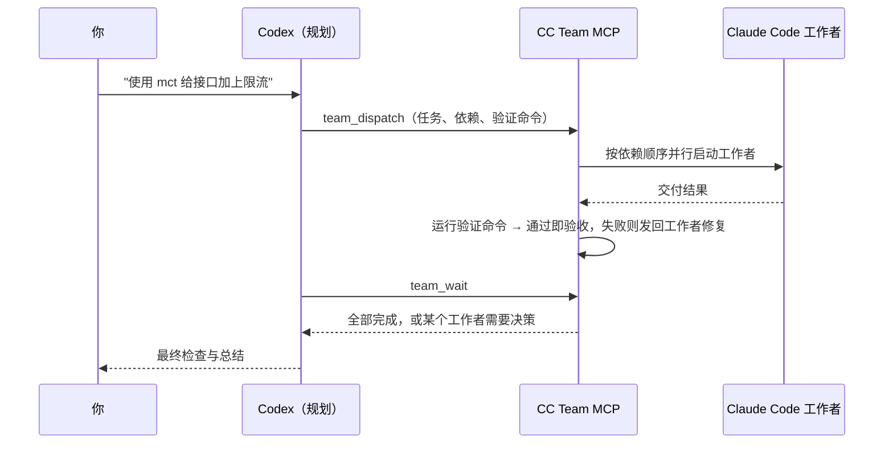

# CC Team MCP

[](https://github.com/lboverfys/mcp-cccx-together/actions/workflows/ci.yml)
[](LICENSE)

[English](README.md) | 简体中文

**Codex 负责规划，Claude Code 并行干活。**

CC Team MCP 是一个本地 [MCP](https://modelcontextprotocol.io) 服务，让 [Codex](https://github.com/openai/codex) 成为一组 [Claude Code](https://code.claude.com) 工作者的规划者和协调者。Codex 拆分任务、一次提交完整计划，然后等待；服务负责并行运行工作者、遵守依赖和文件范围、用你自己的测试命令验证每份结果，只在真正需要决策时才唤醒 Codex。

支持 Windows、macOS 和 Linux，使用标准 MCP stdio 接入。不开放网络端口，不需要额外的 API 密钥——工作者直接复用你已有的 Claude Code 安装、登录和模型配置。

## 目录

- [工作原理](#工作原理)
- [开始之前：权限说明](#开始之前权限说明)
- [安装](#安装)
- [使用](#使用)
- [任务参数](#任务参数)
- [工具](#工具)
- [配置](#配置)
- [恢复工作](#恢复工作)
- [维护](#维护)
- [排查问题](#排查问题)
- [开发](#开发)
- [参与贡献](#参与贡献)

## 工作原理



- **一次派发，一次等待。** Codex 一次提交全部任务，用 `team_wait` 阻塞等待而不是轮询，多数任务只需要几轮 Codex 调用。
- **依赖调度。** `dependsOn` 串联任务；前置结果验收后，下游立即启动，并收到上游交付作为交接。
- **自动验证。** 为任务提供 `verify` 命令（例如 `npm test`）。工作者完成后由服务执行：退出码为 0 即验收；否则把输出发回同一工作者修复，最多 `maxFixRounds` 轮。
- **按范围并行。** 写入范围重叠的任务按提交顺序排队；互不相关的任务并行运行（默认同时 8 个）。
- **状态持久化。** 团队、结果和验收记录保存在磁盘上。关掉 Codex，第二天回来按名字恢复工作者，Claude Code 会话完整保留。

## 开始之前：权限说明

> [!WARNING]
> 默认情况下，工作者以 Claude Code 的 `bypassPermissions` 模式运行：可以**不经确认**地修改文件和执行命令，权限与你的系统用户相同。这正是团队速度快的原因，但只适合你信任的代码和机器。
>
> - `scope` 只控制调度（哪些任务可以同时运行），**不是**沙箱。
> - 写入任务建议在独立的 git worktree、容器或虚拟机中运行。
> - 如需由 Codex 审批工具调用，把 `permissionMode` 设为 `default` 或 `acceptEdits`（见[配置](#配置)）。

工作者不能再创建子 agent，不会运行你的 Claude Code hooks，并且只能看到本服务提供的协作工具（不加载其他 MCP 服务）。

## 安装

### 前置条件

- **Node.js 22+**（包含 npm）
- **Claude Code**：已安装，并能在终端中独立完成一次对话（[安装指南](https://code.claude.com/docs/en/setup)）
- **Codex CLI**，或任何支持本地 stdio 服务的 MCP 客户端
- **Git**（从 GitHub 安装时需要）

### 从 GitHub 安装（推荐）

```sh
npm install -g --omit=optional github:lboverfys/mcp-cccx-together
cc-team-mcp doctor
cc-team-mcp setup
```

- `doctor` 检查 Node、Claude Code、Codex 以及状态/临时目录，不调用模型，也不创建任何文件。
- `setup` 通过 `codex mcp add` 把服务注册为 `cc_team`。已存在同名配置时不会覆盖，可用 `--name` 指定其他名称。
- `--omit=optional` 跳过 Agent SDK 自带的 Claude 程序，直接使用你已安装的 Claude Code。

重新打开 Codex 会话，运行 `/mcp` 确认服务已连接。

> Windows 下如果 PowerShell 阻止 npm 脚本，请使用 `npm.cmd` 和 `cc-team-mcp.cmd`。

### 从源码安装

```sh
git clone https://github.com/lboverfys/mcp-cccx-together.git
cd mcp-cccx-together
npm ci --omit=optional
node src/cli.mjs doctor
node src/cli.mjs setup
```

请保留该目录，Codex 会从这里启动服务；移动目录后需重新运行 `setup`。

### 其他 MCP 客户端

```sh
cc-team-mcp print-config
```

会输出包含当前安装绝对路径的 `mcpServers` JSON 配置，将其加入客户端的本地 MCP 设置即可。

### 卸载

```sh
codex mcp remove cc_team
npm uninstall -g cc-team-mcp
```

已保存的团队状态会保留；不再需要时可删除[状态目录](#配置)。

## 使用

在给 Codex 的请求中提到 **`mct`**（或 **`ctm`**）：

> 使用 mct 帮我实现登录功能，并确保测试通过。

> 使用 ctm 检查这个项目的问题，先只读分析。

随后 Codex 会：

1. 拆分工作，用一次 `team_dispatch` 提交全部任务。团队会自动打开（只有需要设置约束、调整并发或重新打开旧团队时，才先调用 `team_open`）。
2. 调用 `team_wait`，阻塞到所有任务停下或有任务需要处理。
3. 只处理 `attention: true` 的工作者：

   | 状态 | Codex 的处理 |
   | --- | --- |
   | `needs_input` | 用 `team_reply` 回答工作者的问题 |
   | `failed` 或自动验收未通过 | 用 `team_send` 指示修复，或 `team_close` 后重新派发 |
   | `blocked` | 先处理 `blockedBy` 中的上游任务 |
   | `awaiting_review`（`review: "codex"`） | 用 `team_result` 读取结果，再 `team_review` |

4. 重复 `team_wait` 直到 `done: true`，最后做一次整体检查。

### 计划示例

```json
{
  "workers": [
    { "name": "设计cc", "cwd": "/项目/绝对路径", "prompt": "梳理接口契约和验收条件", "scope": ["src"] },
    { "name": "实现cc", "cwd": "/项目/绝对路径", "prompt": "按契约实现功能", "access": "write", "scope": ["src"], "dependsOn": ["设计cc"], "verify": "npm test" },
    { "name": "验证cc", "cwd": "/项目/绝对路径", "prompt": "对照契约检查实现并运行测试", "access": "verify", "dependsOn": ["实现cc"] }
  ]
}
```

`设计cc` 完成后自动验收；`实现cc` 带着设计交接启动，持续修复直到 `npm test` 通过；随后 `验证cc` 检查结果。只有出现卡点时才需要 Codex 介入。

> [!NOTE]
> 工作者说明和工具描述目前使用中文，工作者也用中文汇报。Codex 能理解任何语言的请求。

## 任务参数

`team_dispatch.workers` 中每一项支持：

| 字段 | 默认值 | 说明 |
| --- | --- | --- |
| `name` | — | 简短的职责名。缺少 `cc` 时自动补上；包含 `cc` 最多 10 个字符；同一团队内唯一。 |
| `cwd` | — | 项目目录的绝对路径。 |
| `prompt` | — | 任务内容。写清目标、涉及的文件和验收方式。 |
| `access` | `read` | `read`：仅 Read/Glob/Grep。`verify`：额外提供 Bash，用于运行测试和构建（不应修改文件）。`write`：完整工具集。 |
| `scope` | 整个 `cwd` | 相对于 `cwd` 的路径（不是 glob）。`write` **必填**。写入范围重叠的任务依次执行。 |
| `dependsOn` | `[]` | 需先通过验收的任务名字或 ID，可引用同一批次中的任务。 |
| `verify` | — | 工作者成功后在 `cwd` 中执行的 shell 命令，退出码 0 表示通过，超时 10 分钟。 |
| `review` | `auto` | `auto`：工作者成功且 `verify` 通过即验收。`codex`：等待 Codex 调用 `team_review`。 |
| `maxFixRounds` | `2` | `verify` 失败时自动发回工作者修复的轮数，超过后交给 Codex（0–5）。 |
| `instructions` | — | 该工作者的额外约束。 |
| `model` | Claude Code 默认模型 | 为该工作者覆盖模型。 |
| `maxTurns`、`maxBudgetUsd` | — | 由 Claude Agent SDK 执行的单次运行轮次与预算上限。 |
| `allowedTools` | `[]` | 预先允许的 Claude Code 权限规则（仅在 `permissionMode` 不是 `bypassPermissions` 时有意义）。 |

团队级设置通过 `team_open` 传入：`constraints`（附加到每个工作者说明中的约束）、`maxConcurrent`（同时存活的 Claude Code 进程数，默认 8）和 `teamId`。

## 工具

| 工具 | 用途 |
| --- | --- |
| `team_dispatch` | 批量提交任务；未打开团队时自动打开 |
| `team_wait` | 阻塞到全部任务停下或有任务需要处理，返回精简结果 |
| `team_open` | 创建或重新打开团队，设置约束和并发 |
| `team_list` | 列出已保存的团队 |
| `team_status` | 完整状态：依赖、排队原因、进程、待答复请求、最近结果和验收 |
| `team_events` | 按游标读取原始事件流（用于排查；等待请用 `team_wait`） |
| `team_request` | 读取待答复问题或权限请求的全文 |
| `team_reply` | 回答问题，或允许/拒绝工具调用 |
| `team_result` | 分页读取完整结果（每页最多 100 KB） |
| `team_review` | 验收或拒绝指定版本的结果（必须传 `resultId`） |
| `team_send` | 向工作者追加指令 |
| `team_interrupt` | 中断工作者的当前轮次 |
| `team_resume` | 在原 Claude Code 会话中恢复已关闭的工作者 |
| `team_close` | 关闭指定工作者，保留会话 |
| `team_shutdown` | 关闭全部工作者并释放团队 |

限制：每个工作者最多 32 条待处理消息，保留最近 2000 条事件，每份结果最大 8 MiB。大型产物请保存为项目文件并汇报路径。

## 配置

常规安装无需配置文件。需要自定义时，复制 [`team.config.example.json`](team.config.example.json)，然后通过 `--config /绝对路径/team.config.json`（用于 `doctor`、`setup` 和 `print-config`）或环境变量 `CC_TEAM_CONFIG` 指定。

| 字段 | 环境变量 | 默认值 | 说明 |
| --- | --- | --- | --- |
| `permissionMode` | `CC_TEAM_PERMISSION_MODE` | `bypassPermissions` | `bypassPermissions`、`acceptEdits` 或 `default`（工具调用经 Codex 用 `team_reply` 审批） |
| `waitTimeoutMs` | `CC_TEAM_WAIT_TIMEOUT_MS` | `50000` | 单次 `team_wait` 的最长等待毫秒数，须小于客户端的工具超时 |
| `claudeExecutable` | `CC_TEAM_CLAUDE_EXECUTABLE` | 自动查找 | Claude Code 的绝对路径 |
| `codexExecutable` | `CC_TEAM_CODEX_EXECUTABLE` | 自动查找 | Codex 的绝对路径（用于 `setup` 和通知） |
| `stateDir` | `CC_TEAM_STATE_DIR` | 见下文 | 团队、工作者、事件和结果 |
| `tempDir` | `CC_TEAM_TEMP_DIR` | `<系统临时目录>/cc-team-mcp` | 工作者临时文件 |
| `notificationMode` | `CC_TEAM_NOTIFICATION_MODE` | `poll` | `poll` 或 `codex-queue` |

环境变量优先于配置文件；`--config` 优先于 `CC_TEAM_CONFIG`。`setup` 和 `print-config` 会把显式覆盖写入注册配置，客户端重启后依然生效。默认状态目录：`%LOCALAPPDATA%\cc-team-mcp`（Windows）、`~/Library/Application Support/cc-team-mcp`（macOS）、`$XDG_STATE_HOME/cc-team-mcp` 或 `~/.local/state/cc-team-mcp`（Linux）。

### 延长单次等待

Codex 会在工具超时后终止调用，因此 `team_wait` 默认最多等待 50 秒。长任务想减少 Codex 轮次，可在 `~/.codex/config.toml` 中同时调高两个上限：

```toml
[mcp_servers.cc_team]
tool_timeout_sec = 600

[mcp_servers.cc_team.env]
CC_TEAM_WAIT_TIMEOUT_MS = "570000"
```

### 模型与服务商

工作者使用你已安装的 Claude Code，并加载用户、项目和本地设置，因此沿用 Claude Code 当前的模型、服务商和登录方式。本服务不保存任何凭据。如果服务商通过环境变量配置，需要让 Codex 转发这些变量：

```toml
[mcp_servers.cc_team]
env_vars = ["ANTHROPIC_API_KEY", "ANTHROPIC_AUTH_TOKEN", "ANTHROPIC_BASE_URL", "ANTHROPIC_MODEL", "HTTPS_PROXY", "HTTP_PROXY", "NO_PROXY"]
```

### Windows 启动脚本

在源码目录中，`Start-TeamCodex.ps1` 会在指定项目中启动 Codex，并仅为本次会话挂载本服务——包含上面的延长等待设置和服务商环境变量转发，不修改全局 Codex 配置。

```powershell
.\Start-TeamCodex.ps1 -ProjectPath C:\work\my-app
```

### 主动通知（可选）

设置 `notificationMode: "codex-queue"`，且 Codex 版本支持 `codex queue` 时，服务还会向 `team_open` 中 `parentThreadId` 指定的 Codex 会话推送简短事件摘要，投递状态见 `team_status.notificationDelivery`。不开启也可以正常用 `team_wait` 工作。

## 恢复工作

团队继续工作所需的一切都保存在状态目录中，每个工作者也保留自己的 Claude Code 会话。在新的 Codex 对话中：

> 打开之前的团队，让实现cc 继续完善错误处理。

Codex 会调用 `team_list`，用原 `teamId` 通过 `team_open` 重新打开团队，再按名字调用 `team_resume`。约束、并发、依赖和验收记录都会恢复；尚未投递的消息会保留，并在 `team_resume` 后按顺序发送。

## 维护

运行维护命令前请先关闭团队。两条命令默认只预览，加 `--apply` 才实际执行。

```sh
# 清理历史结果：每个工作者至少保留最近 3 份，以及仍被引用的版本
cc-team-mcp prune --team <团队ID> --keep-results 3
cc-team-mcp prune --team <团队ID> --keep-results 3 --apply

# 异常退出后恢复团队锁或不完整的事件日志（会保留备份）
cc-team-mcp recover --team <团队ID>
cc-team-mcp recover --team <团队ID> --apply
```

升级前请备份状态目录。旧格式会在下次写入时自动迁移；回退版本时恢复备份即可。

## 排查问题

| 问题 | 检查方法 |
| --- | --- |
| 找不到 Claude Code | 确认同一环境下 `claude --version` 可运行，再执行 `cc-team-mcp doctor`，或设置 `claudeExecutable` |
| Codex 中看不到工具 | 检查 `codex mcp list` 和 `/mcp`，确认注册的路径仍然存在，重新打开会话 |
| 工作者鉴权或网络错误 | 在同一环境中单独运行 Claude Code；检查 `env_vars` 转发 |
| `team_wait` 因工具超时失败 | 调低 `CC_TEAM_WAIT_TIMEOUT_MS` 或调高 `tool_timeout_sec`（见[延长单次等待](#延长单次等待)） |
| 任务一直处于 `waiting_scope` | 查看 `blockedBy`，该工作者完成并验收后会自动启动；拆分范围即可并行 |
| 工作者停在 `needs_input` | 用 `team_request` 读取请求，再用 `team_reply` 回答 |
| 提示团队被其他进程占用 | 关闭另一个会话；如为异常退出，运行 `recover` |
| 关闭失败 | Claude Code 后台任务未能确认停止。先自行核实再重试，不要直接删除锁文件 |
| 提示事件日志尾行不完整 | 运行 `recover`（先预览），不要直接删除事件日志 |

状态文件以明文保存任务内容、进度和工具输入。请确保状态目录仅自己可访问，也不要在 issue 中附带。

## 开发

```sh
npm ci --omit=optional
npm run check   # 语法检查
npm test        # 使用模拟的 Claude Code 进程运行全部测试，不调用模型
npm pack --dry-run
```

CI 在 Windows、macOS 和 Linux 上分别使用 Node.js 22 和 24 运行。

`node scripts/smoke-live.mjs` 使用真实的 Claude Code 运行端到端流程（两个只读工作者、提问、多轮和恢复）。**会产生费用**：每个工作进程限制 8 轮和 SDK 估算的 1 美元。加 `--notify` 可同时验证 Codex 通知。

## 参与贡献

欢迎提交 issue 和 pull request。

- **报告问题**：请提供系统和架构、Node 与 Claude Code 版本、脱敏后的 `cc-team-mcp doctor` 输出、最小复现步骤和预期结果。不要附带状态目录或 API 密钥。
- **提交 PR**：附上能复现问题的测试。修改工具协议时，同步更新工具描述、两份 README 和 `scripts/smoke-live.mjs`。CI 必须在三个平台上全部通过。

## 许可证

[MIT](LICENSE)。第三方依赖遵循各自的许可证。
