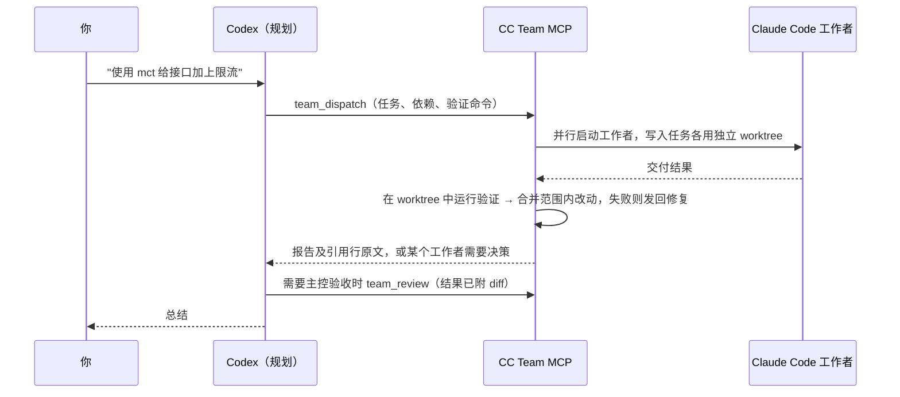

# CC Team MCP

[](https://github.com/lboverfys/mcp-cccx-together/actions/workflows/ci.yml)
[](LICENSE)

[English](README.md) | 简体中文

**Codex 负责规划，快速的工作者并行干活。**

CC Team MCP 是一个本地 [MCP](https://modelcontextprotocol.io) 服务，让 [Codex](https://github.com/openai/codex) 成为一组 [Claude Code](https://code.claude.com) 工作者的规划者和审核者。工作者可以使用 Claude，也可以使用任何提供 Anthropic 兼容接口的模型，例如 DeepSeek。Codex 拆分任务、一次提交完整计划，然后等待。服务负责并行运行工作者，每个写入任务使用独立的 git worktree。服务用你的测试命令检查每份结果，只把分配范围内的改动合并回来，只在需要决策时才唤醒 Codex。

支持 Windows、macOS 和 Linux，使用标准 MCP stdio 接入。不开放网络端口；除非配置了 provider，否则不需要额外的 API 密钥，工作者直接复用你已有的 Claude Code 安装和登录。

> [!NOTE]
> **本项目以中文为主。** 工作者说明、工具描述和错误信息都使用中文，工作者也用中文汇报。Codex 能理解任何语言的请求；中英文 README 同步维护。

**名称说明：** npm 包和命令行工具叫 `cc-team-mcp`；`setup` 在 Codex 中把服务注册为 `cc_team`；在请求中提到 `mct` 或 `ctm` 即可使用。代码仓库名为 `mcp-cccx-together`。

## 目录

- [工作原理](#工作原理)
- [开始之前：权限说明](#开始之前权限说明)
- [安装](#安装)
- [使用](#使用)
- [任务参数](#任务参数)
- [工具](#工具)
- [隔离与合并](#隔离与合并)
- [模型与 provider](#模型与-provider)
- [配置](#配置)
- [恢复工作](#恢复工作)
- [测量速度](#测量速度)
- [维护](#维护)
- [排查问题](#排查问题)
- [开发](#开发)
- [参与贡献](#参与贡献)

## 工作原理



- **一次调用完成委派。** Codex 是慢的一方，所以服务尽量省 Codex 的轮数：`team_dispatch` 一次提交全部任务，默认等到全部停下或有任务需要决策才返回，和 Claude Code 自己的子 agent 一样。之后处理工作者（`team_reply`、`team_send`、`team_review`、`team_resume`）也在同一次调用里接着等待。每次返回的最前面是 `next`，用一句话告诉 Codex 下一步做什么。读代码、搜索、运行命令、修改文件都交给工作者，Codex 不先自己调查。
- **以验证为准，不以自述为准。** 提供 `verify` 命令（例如 `npm test`）时，由服务自己检查结果，失败就发回同一工作者修复，最多 `maxFixRounds` 轮。没有 `verify` 的写入任务由 Codex 验收后才放行下游。
- **同一件事只做一次。** 只读和验证任务完成即自动验收并回收进程，报告全文随派发结果返回。工作者按固定格式简短汇报：开头是 Codex 可以直接转述的答复，带 `文件:行号` 证据，已证实与推测分开。服务会读出每条引用的原文放在 `evidence` 里，并标出不存在的引用，Codex 不用打开文件就能核对，也不重做调查。
- **结果一定送到 Codex。** Codex 放弃了某次等待（工具超时或被中断）时，那次的结果不算已送达，下一次 `team_wait` 会带回来。返回篇幅控制在 Codex 的输出预算之内，超出时先压缩证据和补丁，每份报告的开头都能保留。瞬时 API 错误（限流、过载、网络）由服务在工作者原会话中自动重试，不先惊动 Codex。
- **隔离且并行的写入。** 在 git 仓库中，每个写入任务在独立的 git worktree 中工作，因此范围重叠的写入任务也能并行，各自的测试互不看到对方未完成的修改。验收时只合并任务 `scope` 内的改动，范围外的改动会被拒绝。若其他任务先改了相同的行，服务会把主工作区的最新内容并入该工作者的 worktree，留下冲突标记后发回同一工作者解决。
- **工作者内部并行。** Codex 委派前不读代码，往往拆不开任务；工作者可以拆：它能使用 Claude Code 自带的子 agent，只读和验证任务用只读的 Explore，写入任务还可用 general-purpose，且同样受 `scope` 约束。
- **只跑命令不开会话。** 不写 prompt 的验证任务是命令任务：服务直接运行它的 `verify` 命令，不启动 Claude Code。多个写入完成后的整体测试就用它。
- **依赖调度。** `dependsOn` 串联任务；前置结果验收后，下游立即启动，并收到上游交付作为交接。
- **任意 Anthropic 兼容模型。** 配置一次 provider（例如 DeepSeek），然后按任务选择。
- **状态持久化。** 团队、结果和验收记录保存在磁盘上。关掉 Codex，第二天回来按名字恢复工作者，Claude Code 会话完整保留。

## 开始之前：权限说明

> [!WARNING]
> 默认情况下，工作者以 Claude Code 的 `bypassPermissions` 模式运行：可以**不经确认**地修改文件和执行命令，权限与你的系统用户相同。这正是团队速度快的原因，但只适合你信任的代码和机器。
>
> - 写入任务使用独立的 git worktree（见[隔离与合并](#隔离与合并)）。文件编辑工具（`Edit`、`Write`、`MultiEdit`、`NotebookEdit`）会拒绝任务 `scope` 以外的路径。
> - 这**不是**沙箱：shell 命令仍可读写你的用户能访问的任何位置，`node_modules` 等链接进来的依赖目录与主工作区共享。
> - 不信任的代码请放在容器或虚拟机中运行。
> - 如需由 Codex 审批工具调用，把 `permissionMode` 设为 `default` 或 `acceptEdits`（见[配置](#配置)）。

除非任务设置 `explore: false`，工作者可以创建 Claude Code 子 agent：只读和验证任务只能用只读的 Explore，写入任务还可用 general-purpose。子 agent 不能再创建子 agent，它们的文件修改同样限制在任务的 `scope` 内。工作者不会运行你的 Claude Code hooks，并且只能看到本服务提供的协作工具（不加载其他 MCP 服务）。

## 安装

### 前置条件

- **Node.js 22+**（包含 npm）
- **Claude Code**：已安装，并能在终端中独立完成一次对话（[安装指南](https://code.claude.com/docs/en/setup)）
- **Codex CLI**，或任何支持本地 stdio 服务的 MCP 客户端
- **Git 2.38+**：用于 worktree 隔离（从 GitHub 安装时也需要）

### 从 GitHub 安装（推荐）

```sh
npm install -g --omit=optional github:lboverfys/mcp-cccx-together
cc-team-mcp doctor
cc-team-mcp setup
```

- `doctor` 检查 Node、Claude Code、Codex、状态/临时目录，Codex 是否允许 `team_wait` 足够长时间阻塞（`codexWait`），以及团队工具是否从第一轮起就可见、输出预算是否足够（`codexTools`）。不调用模型，也不创建任何文件。
- `setup` 通过 `codex mcp add` 把服务注册为 `cc_team`。它同时设置 Codex 的工具超时，让 `team_wait` 单次最多可等待 9.5 分钟；把团队工具放进 Codex 的初始工具列表并调大输出预算；并转发 provider 需要的凭据变量（见[延长单次等待](#延长单次等待)和[工具可见性与输出预算](#工具可见性与输出预算)）。已存在同名配置时不会覆盖，可用 `--name` 指定其他名称，或先 `codex mcp remove cc_team` 再按新设置注册。
- `--omit=optional` 跳过 Agent SDK 自带的 Claude 程序，直接使用你已安装的 Claude Code。

重新打开 Codex 会话，运行 `/mcp` 确认服务已连接。

> Windows 下如果 PowerShell 阻止 npm 脚本，请使用 `npm.cmd` 和 `cc-team-mcp.cmd`。

### 从源码安装

```sh
git clone https://github.com/lboverfys/mcp-cccx-together.git
cd mcp-cccx-together
npm ci --omit=optional
node src/cli.mjs doctor
node src/cli.mjs setup
```

请保留该目录，Codex 会从这里启动服务；移动目录后需重新运行 `setup`。

### 其他 MCP 客户端

```sh
cc-team-mcp print-config
```

会输出包含当前安装绝对路径的 `mcpServers` JSON 配置，将其加入客户端的本地 MCP 设置即可。

### 卸载

```sh
codex mcp remove cc_team
npm uninstall -g cc-team-mcp
```

已保存的团队状态会保留；不再需要时可删除[状态目录](#配置)。

## 使用

在给 Codex 的请求中提到 **`mct`**（或 **`ctm`**）：

> 使用 mct 帮我实现登录功能，并确保测试通过。

> 使用 ctm 检查这个项目的问题，先只读分析。

随后 Codex 会：

1. 把已有的线索（报错原文、ID、路径）写成简短 prompt，用一次 `team_dispatch` 提交全部任务，每个独立问题一个工作者；不先自己查代码。团队会自动打开（只有需要设置约束、调整并发或重新打开旧团队时，才先调用 `team_open`）。名字已被占用时任务会自动改名，新名字见 `warnings`；结果返回前重发同一任务（例如调用超时后重发）会接上原任务。
2. 这次调用阻塞到所有任务停下或有任务需要处理，返回内容与 `team_wait` 相同：`next`（下一步做什么）、已停下工作者的报告全文（过长时 `summaryTruncated: true`，再用 `team_result` 续读）、引用行原文 `evidence`，以及本轮耗时 `durationMs` 和轮数 `turns`。等待超时（`timedOut: true`）时 Codex 再调用 `team_wait`。Codex 手上有不相关的工作时可以传 `wait: false` 立即返回。
3. 按 `next` 只处理 `attention: true` 的工作者；`team_reply`、`team_send`、`team_review`、`team_resume` 处理后在同一次调用里继续等待：

   | 状态 | Codex 的处理 |
   | --- | --- |
   | `needs_input` | 用 `team_reply` 回答工作者的问题 |
   | `failed` 或自动验收未通过 | 用 `team_send` 指示修复，或 `team_close` 后重新派发 |
   | `stopped` | 工作进程已退出；用 `team_resume` 恢复，或关闭 |
   | `blocked` | 先处理 `blockedBy` 中的上游任务 |
   | `awaiting_review` | 查看结果附带的 `diff`（补丁过长时用 `team_diff` 翻页），再 `team_review` |

4. 直到 `done: true`，然后转述报告。有多个写入任务时，整体测试由同一批中依赖全部写任务的命令任务完成（`access: "verify"`、填 `verify` 命令、不写 `prompt`），不由 Codex 自己跑。自动验收的只读和验证工作者已自动关闭，无需 `team_close`，追问用 `team_resume`。

工作者只在操作具有破坏性、或猜错会白做时才向 Codex 提问（`needs_input`）；其余情况按最合理的理解继续，并在报告里写明所作假设。

### 计划示例

```json
{
  "workers": [
    { "name": "设计cc", "cwd": "/项目/绝对路径", "prompt": "梳理接口契约和验收条件", "scope": ["src"] },
    { "name": "接口cc", "cwd": "/项目/绝对路径", "prompt": "按契约实现接口部分", "access": "write", "scope": ["."], "dependsOn": ["设计cc"], "verify": "auto", "provider": "deepseek" },
    { "name": "界面cc", "cwd": "/项目/绝对路径", "prompt": "按契约实现界面部分", "access": "write", "scope": ["."], "dependsOn": ["设计cc"], "verify": "auto" },
    { "name": "测试cc", "cwd": "/项目/绝对路径", "access": "verify", "verify": "npm test", "dependsOn": ["接口cc", "界面cc"] }
  ]
}
```

1. `设计cc` 是只读任务，默认完成即通过验收，随后进程自动关闭。
2. `接口cc`（使用 DeepSeek）和 `界面cc` 从设计交接同时开始，各自在独立 worktree 中工作。`verify: "auto"` 按项目文件找出测试命令（这里是 `npm test`），各自修复到通过后把改动合并回主工作区；两者改了相同的行时，后合并的一方会收到冲突并自行解决。
3. `测试cc` 是命令任务：两个写入都合并后，服务直接在主工作区运行 `npm test`，不启动 Claude Code，输出随 `team_wait` 返回给 Codex。

## 任务参数

`team_dispatch.workers` 中每一项支持：

| 字段 | 默认值 | 说明 |
| --- | --- | --- |
| `name` | — | 简短的职责名。缺少 `cc` 时自动补上；包含 `cc` 最多 24 个字符（超长自动截短）。团队里已有同名工作者时自动改名（`接口cc` → `接口2cc`）并在 `warnings` 中说明；结果返回前重发同一任务会接上原任务。 |
| `cwd` | — | 项目目录的绝对路径。 |
| `prompt` | — | 任务内容。写清要回答的问题或目标，以及已有的线索；搜索交给工作者。填了 `verify` 的验证任务省略它即为命令任务。 |
| `access` | `read` | `read`：仅 Read/Glob/Grep。`verify`：额外提供 Bash，用于测试、构建、查 git 历史和日志或运行程序（不应修改文件）。`write`：完整工具集。 |
| `scope` | 整个 `cwd` | 相对于 `cwd` 的路径（不是 glob）。文件编辑工具和合并都限制在该范围内。git 仓库中的写入任务在独立 worktree 中修改、只合并范围内改动，可以省略；不在 git 仓库中的写入任务直接改你的文件，**必须**填写。隔离的写入任务范围重叠也并行；共享工作区的写入和验证任务会等待范围重叠的写入。 |
| `dependsOn` | `[]` | 需先通过验收的任务名字或 ID，可引用同一批次中的任务。 |
| `verify` | — | 工作者成功后执行的 shell 命令；隔离任务在其 worktree 中执行。退出码 0 表示通过，超时 10 分钟。填 `auto` 时按项目文件推断（`package.json` 的 test 脚本、`go.mod`、`Cargo.toml`、pytest 配置、Gradle、Maven、.NET、`make test`），向上查找到仓库根目录为止；找不到时写入任务退回 Codex 验收，其他任务忽略 `verify`。自动验收的写入工作者会被告知这条命令，自己只跑定向检查，不再完整跑一遍。 |
| `review` | `read`/`verify` 任务和带 `verify` 的写入任务为 `auto`，其余为 `codex` | `auto`：工作者成功且 `verify`（如有）通过即验收；`read`/`verify` 任务随后自动关闭进程。`codex`：等待 Codex 调用 `team_review`。写入任务使用 `auto` 必须提供 `verify`。 |
| `explore` | `true` | 允许工作者在值得时把工作分给 Claude Code 子 agent 并行：只读和验证任务用 Explore，写入任务还可用 general-purpose。子 agent 不能再嵌套。设为 `false` 关闭。 |
| `maxFixRounds` | `2` | `verify` 失败、改动越界或合并冲突时自动发回工作者修复的轮数，超过后交给 Codex（0–5）。`verify` 命令根本无法运行（找不到命令）时直接交给 Codex。 |
| `isolation` | git 仓库中的写入任务为 `worktree` | `worktree` 或 `shared`，见[隔离与合并](#隔离与合并)。 |
| `links` | `node_modules`、`.venv`、`venv` | 从主工作区链接进 worktree 的被忽略路径（相对 `cwd`），例如 `.env`。仅在 `worktree` 下生效。 |
| `provider` | `defaultProvider`（如已设置） | 运行该工作者的 provider，见[模型与 provider](#模型与-provider)。 |
| `instructions` | — | 该工作者的额外约束。 |
| `model` | provider 的模型，或 Claude Code 默认模型 | 为该工作者覆盖模型。 |
| `maxTurns`、`maxBudgetUsd` | — | 由 Claude Agent SDK 执行的单次运行轮次与预算上限。`maxBudgetUsd` 按 Anthropic 价格估算，对其他 provider 不构成真实上限。 |
| `allowedTools` | `[]` | 预先允许的 Claude Code 权限规则（仅在 `permissionMode` 不是 `bypassPermissions` 时有意义）。 |

团队级设置通过 `team_open` 传入：`constraints`（附加到每个工作者说明中的约束）、`maxConcurrent`（同时存活的 Claude Code 进程数，默认 8）和 `teamId`。

## 工具

| 工具 | 用途 |
| --- | --- |
| `team_dispatch` | 批量提交任务（未打开团队时自动打开）；除非 `wait: false`，否则等待并返回与 `team_wait` 相同的内容 |
| `team_wait` | 阻塞到全部任务停下或有任务需要处理，返回 `next`、已停下工作者的报告全文、引用行原文（`evidence`）和待验收写入的 diff；没有可等的工作者时补发一次最近一批结果（`repeated: true`） |
| `team_open` | 创建或重新打开团队，设置约束和并发；列出已配置的 provider |
| `team_list` | 列出已保存的团队 |
| `team_status` | 完整状态：依赖、排队原因、进程、worktree、待答复请求、最近结果和验收，以及耗时统计 `timing`（见[测量速度](#测量速度)） |
| `team_events` | 按游标读取原始事件流（用于排查；等待请用 `team_wait`） |
| `team_request` | 读取待答复问题或权限请求的全文 |
| `team_reply` | 回答问题，或允许/拒绝工具调用；除非 `wait: false`，随后像 `team_wait` 一样等待 |
| `team_result` | 分页读取完整结果（默认页长随 `responseBytes` 调整，最多 100 KB） |
| `team_diff` | 查看隔离任务尚未合并的改动：文件、越界文件、统计和分页补丁 |
| `team_review` | 验收或拒绝指定版本的结果（必须传 `resultId`）；验收隔离任务时合并其改动，合并冲突时发回工作者解决（`sentBack: true`）。除非 `wait: false`，随后像 `team_wait` 一样等待 |
| `team_send` | 向工作者追加指令；除非 `wait: false`，随后像 `team_wait` 一样等待 |
| `team_interrupt` | 中断工作者的当前轮次 |
| `team_resume` | 在原 Claude Code 会话中恢复已关闭的工作者，保留其上下文；除非 `wait: false`，随后像 `team_wait` 一样等待 |
| `team_close` | 关闭指定工作者，保留会话 |
| `team_shutdown` | 关闭全部工作者并释放团队 |

限制：每个工作者最多 32 条待处理消息，保留最近 2000 条事件，每份结果最大 8 MiB。大型产物请保存为项目文件并汇报路径。

## 隔离与合并

`cwd` 位于 git 仓库内的写入任务默认在独立的 [git worktree](https://git-scm.com/docs/git-worktree) 中运行。不在 git 仓库中时直接修改你的文件（`shared`），`team_dispatch` 会返回警告。

- **起点。** worktree 以任务启动时主工作区的快照为起点，包括未提交的修改和未被忽略的未跟踪文件；同时启动的写入任务共用一次快照。你的分支、索引和 `HEAD` 都不会改动；快照提交不挂在任何分支上。
- **位置。** `<stateDir>/<teamId>/worktrees/<workerId>`。状态目录必须位于仓库之外。
- **依赖。** 测试需要的被忽略目录会从主工作区链接进来：默认 `node_modules`、`.venv` 和 `venv`，可用 `links` 添加更多。链接目录是共享的，工作者重装依赖会改动主工作区的 `node_modules`。
- **路径。** 发给工作者的消息中指向项目的绝对路径会改写为 worktree 路径；文件编辑工具拒绝 worktree 中范围以外的路径。
- **验收即合并。** 结果被验收时（自动验收或 `team_review`），服务取出工作者自起点以来的改动：
  - 每个改动的路径都必须在 `scope` 内，否则验收失败。自动验收会在 `maxFixRounds` 内把越界清单发回工作者；`team_review` 返回错误。
  - 期间你或其他任务改过相同文件时做三方合并。冲突时不合并任何文件：服务把主工作区当前内容并入工作者的 worktree 并留下冲突标记，把它的起点推进到当前内容，再把冲突文件清单发回该工作者（自动验收时计入 `maxFixRounds`）。工作者再次汇报后照常经过 `verify` 和合并。
  - 合并结果只写入你的工作区文件，不会暂存或提交。
- **并行工作。** 隔离的写入任务在合并前不改动你的工作区，因此范围重叠的只读任务和其他隔离写入任务可以同时运行。验证任务会在工作区里运行命令，仍需排队。
- **合并前检查。** 等待 Codex 验收的写入结果附带改动文件、越界文件和最多 12,000 字符的补丁；其余部分用 `team_diff` 翻页查看。
- **清理。** 关闭工作者时，已全部合并的 worktree 会被删除；仍有未合并改动的会保留（路径见 `team_status`）。`team_resume` 会在原路径重建已删除的 worktree，Claude Code 会话因此可以继续。`prune` 会清理遗留的无改动 worktree。

下游任务的快照在上游改动合并之后才创建，因此能看到这些改动。

## 模型与 provider

默认情况下，工作者使用你已安装的 Claude Code，并加载用户、项目和本地设置，即沿用 Claude Code 当前的模型、服务商和登录方式。本服务不保存任何凭据。

要把工作者接到其他 Anthropic 兼容接口，在[配置文件](#配置)中定义 **provider**。`env` 写非机密的值；`envFrom` 从 MCP 服务已有的环境变量复制机密，密钥不必写进文件：

```json
{
  "providers": {
    "deepseek": {
      "description": "通过 Anthropic 兼容接口使用 DeepSeek",
      "env": {
        "ANTHROPIC_BASE_URL": "https://api.deepseek.com/anthropic",
        "ANTHROPIC_DEFAULT_HAIKU_MODEL": "deepseek-chat"
      },
      "envFrom": { "ANTHROPIC_AUTH_TOKEN": "DEEPSEEK_API_KEY" },
      "model": "deepseek-chat"
    }
  },
  "defaultProvider": "deepseek"
}
```

- 用任务的 `provider` 字段按任务选择，或用 `defaultProvider`（或 `CC_TEAM_DEFAULT_PROVIDER`）设为所有任务的默认值。Codex 能在服务说明和 `team_open` 的返回中看到 provider 列表。
- `setup` 会把 `envFrom` 的来源变量（此例中为 `DEEPSEEK_API_KEY`）加入 Codex 的 `env_vars`，由 Codex 转发给服务；Windows 启动脚本也会这样做。需要的变量未设置时，派发会给出明确的错误。
- **DeepSeek：** 上面的接口地址来自 DeepSeek 的 [Anthropic API 指南](https://api-docs.deepseek.com/zh-cn/guides/anthropic_api)。模型名称会随版本变化，请以该指南为准。把 `ANTHROPIC_DEFAULT_HAIKU_MODEL`（以及 Claude Code 用到的 Sonnet/Opus 对应变量）指向 DeepSeek 的模型，Claude Code 的后台调用也会走 DeepSeek。
- 如果 `~/.claude/settings.json` 的 `env` 中设置了 `ANTHROPIC_*` 变量，Claude Code 可能优先使用它们；请改为写进 provider。
- **费用：** `costUsd` 和 `maxBudgetUsd` 是 SDK 按 Anthropic 价格的估算。使用其他 provider 的工作者，其结果带有 `costReliable: false`，设置 `maxBudgetUsd` 会收到警告；请用 `maxTurns` 控制工作量。

如果 Claude Code 本身通过环境变量配置服务商（不使用 provider），需要让 Codex 转发这些变量：

```toml
[mcp_servers.cc_team]
env_vars = ["ANTHROPIC_API_KEY", "ANTHROPIC_AUTH_TOKEN", "ANTHROPIC_BASE_URL", "ANTHROPIC_MODEL", "HTTPS_PROXY", "HTTP_PROXY", "NO_PROXY"]
```

## 配置

常规安装无需配置文件。需要自定义时，复制 [`team.config.example.json`](team.config.example.json)，然后通过 `--config /绝对路径/team.config.json`（用于 `doctor`、`setup` 和 `print-config`）或环境变量 `CC_TEAM_CONFIG` 指定。

| 字段 | 环境变量 | 默认值 | 说明 |
| --- | --- | --- | --- |
| `permissionMode` | `CC_TEAM_PERMISSION_MODE` | `bypassPermissions` | `bypassPermissions`、`acceptEdits` 或 `default`（工具调用经 Codex 用 `team_reply` 审批） |
| `waitTimeoutMs` | `CC_TEAM_WAIT_TIMEOUT_MS` | `50000`（`setup` 注册为 `570000`） | 单次 `team_wait` 的最长等待毫秒数，须小于客户端的工具超时 |
| `responseBytes` | `CC_TEAM_RESPONSE_BYTES` | `40000`（`setup` 注册为 `96000`） | 等待类调用单次返回的最大 UTF-8 字节数，须在客户端对这些工具的输出预算之内 |
| `providers` | — | 无 | 命名的 Anthropic 兼容 provider（见[模型与 provider](#模型与-provider)） |
| `defaultProvider` | `CC_TEAM_DEFAULT_PROVIDER` | 无 | 任务未指定 provider 时使用的 provider |
| `claudeExecutable` | `CC_TEAM_CLAUDE_EXECUTABLE` | 自动查找 | Claude Code 的绝对路径 |
| `codexExecutable` | `CC_TEAM_CODEX_EXECUTABLE` | 自动查找 | Codex 的绝对路径（用于 `setup` 和通知） |
| `stateDir` | `CC_TEAM_STATE_DIR` | 见下文 | 团队、工作者、事件、结果和 worktree；请放在仓库之外 |
| `tempDir` | `CC_TEAM_TEMP_DIR` | `<系统临时目录>/cc-team-mcp` | 工作者临时文件 |
| `notificationMode` | `CC_TEAM_NOTIFICATION_MODE` | `poll` | `poll` 或 `codex-queue` |

环境变量优先于配置文件；`--config` 优先于 `CC_TEAM_CONFIG`。`setup` 和 `print-config` 会把显式覆盖写入注册配置，客户端重启后依然生效。默认状态目录：`%LOCALAPPDATA%\cc-team-mcp`（Windows）、`~/Library/Application Support/cc-team-mcp`（macOS）、`$XDG_STATE_HOME/cc-team-mcp` 或 `~/.local/state/cc-team-mcp`（Linux）。

### 延长单次等待

Codex 会在工具超时后终止调用。无论是 `team_dispatch` 还是 `team_wait`，每次等待超时都要多花一轮 Codex，因此等待越长，慢速的 Codex 轮次越少。上限低于两分钟时，超时结果会带上 `hint` 提示这一点。

`setup` 会自动处理：注册 `CC_TEAM_WAIT_TIMEOUT_MS = 570000`，并在 `~/.codex/config.toml`（或 `$CODEX_HOME/config.toml`）的 `[mcp_servers.cc_team]` 表中写入 `tool_timeout_sec = 600`。如果你自己设置了 `waitTimeoutMs`，`setup` 会保留该值，并把工具超时设为比它多 30 秒。无法修改该文件时，`setup` 改为注册安全的 50 秒默认值，并输出手动步骤。

`cc-team-mcp doctor` 会从 Codex 配置中读出这两个设置，放在 `checks.codexWait` 中，等待过短时附带提示。

即使 Codex 还是放弃了某次等待（它的工具超时短于服务端单次等待，或你中断了它），结果也不会丢：那次等待里的结果不算已送达，下一次 `team_wait` 会带回来，并附上检查配置的 `hint`。Codex 以超时理由取消调用时，之后的等待会在这个时长之前以 `timedOut: true` 返回，不再在 Codex 侧报错。

手动配置时请同时调高两个上限：

```toml
[mcp_servers.cc_team]
tool_timeout_sec = 600

[mcp_servers.cc_team.env]
CC_TEAM_WAIT_TIMEOUT_MS = "570000"
```

### 工具可见性与输出预算

较新的 Codex 按需加载 MCP 工具：模型要先调一次 `tool_search` 才能看到 `team_dispatch`，每个会话都多一轮慢回合。Codex 还会截断过长的工具输出，而且不会去翻被截掉的部分，多工作者结果的中间一段可能就此丢失。所以 `setup` 还会在同一个表中写入：

```toml
[mcp_servers.cc_team]
omit_tools_from = ["deferred"]               # 团队工具直接进入 Codex 的初始工具列表
tools.team_wait.output_token_limit = 40000   # team_dispatch、team_send、team_reply、team_resume、team_review、team_result、team_diff、team_status 同样设置
```

并配套注册 `CC_TEAM_RESPONSE_BYTES = 96000`。不认识这些键的 Codex 版本会忽略它们。写入后 `setup` 会确认 Codex 仍能读取配置，读不了就还原文件。`doctor` 在 `checks.codexTools` 中报告这两项。没有这些设置时，服务把每次返回控制在 40,000 字节以内，适配 Codex 的默认预算。

### Windows 启动脚本

在源码目录中，`Start-TeamCodex.ps1` 会在指定项目中启动 Codex，并仅为本次会话挂载本服务。挂载内容包括延长等待设置、工具可见性与输出预算，以及服务商环境变量（含 `envFrom` 引用的变量）的转发。全局 Codex 配置不会被修改。

```powershell
.\Start-TeamCodex.ps1 -ProjectPath C:\work\my-app
```

### 主动通知（可选）

设置 `notificationMode: "codex-queue"`，且 Codex 版本支持 `codex queue` 时，服务还会向 `team_open` 中 `parentThreadId` 指定的 Codex 会话推送简短事件摘要，投递状态见 `team_status.notificationDelivery`。不开启也可以正常用 `team_wait` 工作。

## 恢复工作

团队继续工作所需的一切都保存在状态目录中，每个工作者也保留自己的 Claude Code 会话。在新的 Codex 对话中：

> 打开之前的团队，让实现cc 继续完善错误处理。

Codex 会调用 `team_list`，用原 `teamId` 通过 `team_open` 重新打开团队，再按名字调用 `team_resume`。约束、并发、依赖、验收记录和 worktree 都会恢复；尚未投递的消息会保留，并在 `team_resume` 后按顺序发送。

## 测量速度

委派的目的是更快完成，所以要测量而不是凭感觉判断。服务会为每个团队计时：

- `codex`：Codex 在两次调用本服务之间自己花的时间（推理、自行运行的工具和回复）及次数。第一次调用之前的规划时间无法观测。超过 5 分钟的间隔通常包含你自己的时间，只计数不计时（`longGapsExcluded`）。
- `mcpCalls`：调用本服务的次数，以及 Codex 阻塞在 `team_dispatch` 和 `team_wait` 中的时间。
- `workerRunMs`、`verifyMs`、`mergeMs`、`worktreeMs`：Claude Code 的运行时间（命令任务为命令耗时），以及服务自身的验证、合并和建 worktree 时间。每个工作者的明细见 `team_status`。

可以让 Codex 调用 `team_status`，也可以随时在终端查看（团队打开期间也可以）：

```sh
cc-team-mcp stats --team <团队ID>
```

Codex 自己的回合通常占大头。两项设置能减少这部分时间：

- 延长单次等待（见[延长单次等待](#延长单次等待)），工作者运行期间 Codex 不必每 50 秒被唤醒一次。
- 委派会话使用较低的 Codex 推理强度，例如建一个 `model_reasoning_effort = "medium"` 的 Codex profile。使用 mct 时 Codex 主要负责拆分任务和转述报告。

## 维护

运行 `prune` 或 `recover` 前请先关闭团队。两条命令默认只预览，加 `--apply` 才实际执行。

```sh
# 清理历史结果（每个工作者至少保留最近 3 份，以及仍被引用的版本），
# 以及已关闭工作者中没有未合并改动的 worktree
cc-team-mcp prune --team <团队ID> --keep-results 3
cc-team-mcp prune --team <团队ID> --keep-results 3 --apply

# 异常退出后恢复团队锁或不完整的事件日志（会保留备份）
cc-team-mcp recover --team <团队ID>
cc-team-mcp recover --team <团队ID> --apply
```

升级前请备份状态目录。旧格式会在下次写入时自动迁移；回退版本时恢复备份即可。各版本的行为变化见[更新日志](CHANGELOG.md)。

## 排查问题

| 问题 | 检查方法 |
| --- | --- |
| 找不到 Claude Code | 确认同一环境下 `claude --version` 可运行，再执行 `cc-team-mcp doctor`，或设置 `claudeExecutable` |
| Codex 中看不到工具 | 检查 `codex mcp list` 和 `/mcp`，确认注册的路径仍然存在，重新打开会话 |
| 工作者鉴权或网络错误 | 在同一环境中单独运行 Claude Code；检查 `env_vars` 转发 |
| 提示 provider“需要环境变量” | `envFrom` 的来源变量没有传到服务。重新运行 `setup`，或把它加入 `env_vars` |
| `team_wait` 因工具超时失败，或返回的 `hint` 提示上一次等待被放弃 | 调低 `CC_TEAM_WAIT_TIMEOUT_MS` 或调高 `tool_timeout_sec`（见[延长单次等待](#延长单次等待)）。被放弃的那次等待里的结果会随下一次 `team_wait` 返回 |
| Codex 要先调 `tool_search` 才能用 `team_dispatch` | 工具被延迟加载。用 `setup` 重新注册，或加入 `omit_tools_from = ["deferred"]`（见[工具可见性与输出预算](#工具可见性与输出预算)） |
| 返回带 `compacted: true` 或 `summaryTruncated: true` | 返回篇幅达到 `responseBytes`。用 `team_result` 或 `team_diff` 读取其余部分，或同时调大 `responseBytes` 和这些工具的 `output_token_limit` |
| 工作者遇到 API 错误后仍处于 `running` | 服务对瞬时 API 错误（429、5xx、过载、网络）在原会话中先等 15 秒、再等 45 秒各重试一次，`team_events` 中可见 `api_retry_scheduled`；两次都失败后工作者变为 `failed` 并交给 Codex |
| 验收失败，提示“超出分配范围” | `team_diff` 会列出 `outsideScope`。让工作者撤销这些文件，或扩大 `scope` 后重新派发 |
| 验收失败，提示“冲突” | 冲突已发回工作者但 `maxFixRounds` 用完，或工作者进程已退出。用 `team_resume` 让工作者解决，或拒绝该结果后基于当前状态重新派发 |
| 自动验收失败，提示“找不到命令或程序” | `verify` 命令在该目录无法运行。修正命令（或改用 `auto`）后 `team_send` 给工作者，或由 Codex 自行验收 |
| worktree 中 `verify` 报缺少模块 | 把测试需要的被忽略目录或文件加入 `links` |
| 提示“stateDir 位于该 git 仓库内” | 把 `stateDir` 移到仓库之外，或使用 `isolation: "shared"` |
| 任务一直处于 `waiting_scope` | 查看 `blockedBy`，该工作者完成并验收后会自动启动。只有共享工作区的写入和验证任务会等待范围重叠的任务；拆分范围即可并行 |
| 工作者停在 `needs_input` | 用 `team_request` 读取请求，再用 `team_reply` 回答 |
| 提示团队被其他进程占用 | 关闭另一个会话；如为异常退出，运行 `recover` |
| 关闭失败 | Claude Code 后台任务未能确认停止。先自行核实再重试，不要直接删除锁文件 |
| 提示事件日志尾行不完整 | 运行 `recover`（先预览），不要直接删除事件日志 |

状态文件以明文保存任务内容、进度和工具输入。请确保状态目录仅自己可访问，也不要在 issue 中附带。报告安全问题请参阅 [SECURITY.md](SECURITY.md)。

## 开发

```sh
npm ci --omit=optional
npm run check   # 语法检查
npm test        # 使用模拟的 Claude Code 进程和临时 git 仓库运行全部测试，不调用模型
npm pack --dry-run
```

CI 在 Windows、macOS 和 Linux 上分别使用 Node.js 22 和 24 运行。

`node scripts/smoke-live.mjs` 使用真实的 Claude Code 运行端到端流程（两个只读工作者、提问、多轮和恢复）。**会产生费用**：每个工作进程限制 8 轮和 SDK 估算的 1 美元。加 `--notify` 可同时验证 Codex 通知。

代码结构：`src/server.mjs`（MCP 工具）、`src/manager.mjs`（团队状态机与调度）、`src/claude-worker.mjs`（单个 Claude Code 进程）、`src/isolation.mjs` 与 `src/worktree.mjs`（worktree 与合并）、`src/store.mjs` 与 `src/results.mjs`（持久化状态）、`src/evidence.mjs`（读出报告引用的代码行）、`src/budget.mjs`（等待类返回的篇幅预算）、`src/providers.mjs`、`src/config.mjs`、`src/cli.mjs`。

## 参与贡献

欢迎提交 issue 和 pull request。

- **报告问题**：请提供系统和架构、Node、git 与 Claude Code 版本、脱敏后的 `cc-team-mcp doctor` 输出、最小复现步骤和预期结果。不要附带状态目录或 API 密钥。
- **提交 PR**：附上能复现问题的测试。修改工具协议时，同步更新工具描述、两份 README、`CHANGELOG.md` 和 `scripts/smoke-live.mjs`。面向工作者的文字保持中文。CI 必须在三个平台上全部通过。

## 许可证

[MIT](LICENSE)。第三方依赖遵循各自的许可证。`@anthropic-ai/claude-agent-sdk` 不是开源软件，按 Anthropic 的[法律条款](https://code.claude.com/docs/en/legal-and-compliance)提供；安装和运行本项目时适用这些条款。
